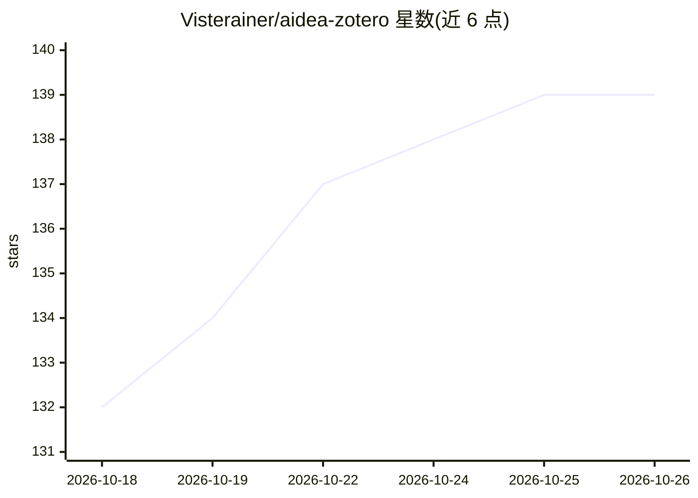

# Visterainer/aidea-zotero

⭐ 139 · TypeScript · AGPL-3.0 · 推送 2026-10-23 · [GitHub](https://github.com/Visterainer/aidea-zotero) · 个人维护 · 中文 README

**给 Zotero 用户的 AI 助手插件：论文对话、划词与全文翻译**

Zotero 7 插件，在侧边栏提供论文问答、PDF/EPUB 划词翻译与全文双语 PDF 导出；支持选中段落附加上下文、截图等多模态输入、快捷操作与本地记忆系统（按文库隔离、Jaccard 去重、全本地存储）。接入方式覆盖 OAuth 订阅账号（ChatGPT、GitHub Copilot，无需 API key）、任意 OpenAI 兼容 API（DeepSeek、OpenRouter 等）及本地模型（Ollama/LM Studio/vLLM）。全文翻译依赖插件按钮安装的 pdf2zh_next Python 环境，OpenAI OAuth 需自动安装 Node.js。会话与 OAuth 令牌均本地存储。

## 筛选速览

| 维度 | 判定 | 备注 |
|---|---|---|
| AI 角色 | `ai-native` | 本体是模型或模型工具 |
| 许可风险 | `viral` | AGPL-3.0 |
| 部署形态 | `library` | 以包/库形式分发 |
| 模型依赖 | local-ok | 支持本地模型 |
| 硬件要求 | — | 无带数字的原话,不猜 |
| 安装摩擦 | `low` | 无编译、无系统依赖或容器化 |
| 成熟度 | — | 结构信号不足 |

## 能力要点

- OAuth 订阅账号登录（ChatGPT/GitHub Copilot），无需 API key
- 划词翻译与全文双语 PDF 翻译导出
- 兼容任意 OpenAI 兼容 API 与本地模型（Ollama/LM Studio/vLLM）
- 按文库隔离的本地记忆系统与聊天历史本地存储

## 适用场景

- 读论文时在 Zotero 侧边栏直接向 AI 提问并获取带引用的回答
- 在 PDF/EPUB 阅读器中划词翻译并把译文写入笔记或批注
- 将整篇论文翻译导出为双语 PDF
- 用已有的 ChatGPT/Copilot 订阅或本地模型接入，不额外购买 API

## 场景标签

`文档问答` `AI 写作` `AI 助手` · 领域:对话与助手

## 证据(README 行号)

> L19:  A free, open-source AI assistant for Zotero
> L20:  💬 Chat with your papers · ✍️ Translate selected text · 📄 Translate full PDFs into bilingual documents
> L23:  🔐 Your existing subscription — ChatGPT or GitHub Copilot via OAuth, no API key needed
> L25:  💻 Local models — Ollama, LM Studio, vLLM, your data stays on your machine

## 星数曲线

2026-10-18 132 → 2026-10-26 139（+7）

---
*卡片 v1 · prompt 1.4 · 生成 2026-10-22 · 置信度 mid · 依据 README sha `832093f08873` · [字段定义](../../DATASET.md)*
