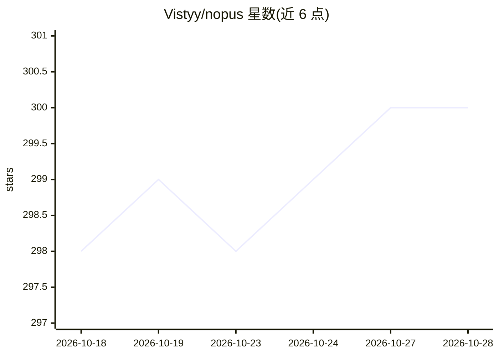

# Vistyy/nopus

⭐ 300 · TypeScript · MIT · 推送 2026-08-19 · [GitHub](https://github.com/Vistyy/nopus) · 个人维护

**检测编码代理回答冗语的确定性文风检查插件**

面向 Pi、Claude Code、Codex 三种编码代理的插件：在代理完成回答后用确定性文风测量（罕见词、抽象词汇与句子、名词堆叠、短语密度、套路化表达）判断是否超过选定复杂度阈值，超过则通过 Stop hook 请求一次更清晰的改写。测量前剔除代码块、URL、文件路径与表格行，降低技术术语权重；三档灵敏度对应的观测改写率为 5.3%/9.9%/18.6%（基于 5,337 条 Pi 回答）。词频与具体性数据来自打包的 SUBTLEX-US、Norvig n-grams、Brysbaert 数据集等。需 Node.js 22+，从 npm 或 GitHub 安装。

## 筛选速览

| 维度 | 判定 | 备注 |
|---|---|---|
| AI 角色 | `ai-ecosystem` | LLM/agent 周边工具 |
| 许可风险 | `permissive` | MIT |
| 部署形态 | `library` | 以包/库形式分发 |
| 模型依赖 | — | README 未给出锁定关系 |
| 硬件要求 | — | 无带数字的原话,不猜 |
| 安装摩擦 | `low` | 无编译、无系统依赖或容器化 |
| 成熟度 | — | 结构信号不足 |

## 能力要点

- 确定性测量：相同文本与灵敏度产生相同判定，不调用 LLM
- 检测罕见词、抽象表述、名词堆叠、短语密度与套路化风格线索
- 三档灵敏度与可配置的额外精简改写模式
- 单次自动改写上限，避免重试循环

## 适用场景

- 让编码代理的回答自动避免抽象冗长的表述
- 在 Pi/Claude Code/Codex 中自动请求更清晰的改写
- 手动触发单条回答的简化改写

## 场景标签

 · 领域:开发工具/LLM 输出质量

## 证据(README 行号)

> L9: nopus catches coding-agent answers that disappear into abstract LLM babble.
> L16: Currently supported: Pi, Claude Code, Codex
> L77: nopus examines the prose when a coding agent completes a response.

## 星数曲线

2026-10-18 298 → 2026-10-28 300（+2）

---
*卡片 v1 · prompt 1.4 · 生成 2026-10-22 · 置信度 high · 依据 README sha `c9f875497db5` · [字段定义](../../DATASET.md)*
