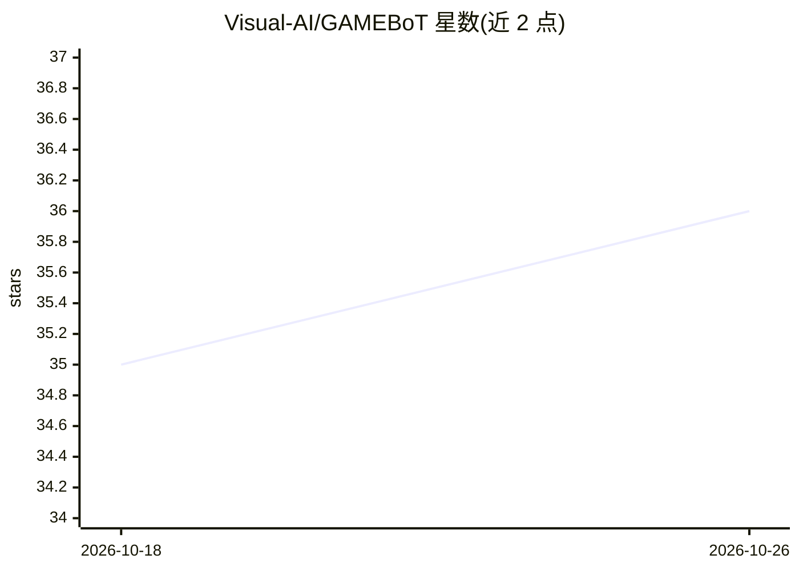

# Visual-AI/GAMEBoT

⭐ 36 · Python · 推送 2026-05-15 · [GitHub](https://github.com/Visual-AI/GAMEBoT) · [官网](https://visual-ai.github.io/gamebot/) · 组织维护

**ACL 2025 论文的 LLM 游戏对弈推理评测基准**

通过让 LLM 在 8 个游戏（Checkers、TicTacToe、Connect4、Othello、Pong、Surround、Negotiate、Texas Hold'em）中直接对弈来评测其推理能力的基准框架。除胜负结果外，还记录并可视化游戏日志与中间推理步骤，支持添加新 LLM Agent（实现 get_response_text 接口并注册）。已评测 GPT-4o、Gemini、Claude、DeepSeek-R1、o1/o3-mini 等模型。运行需 Python 3.10，克隆仓库并安装依赖，在 keys.py 配置 API key 后用命令行脚本运行对局，多数模型经 Google Vertex Cloud 等云 API 访问。

## 筛选速览

| 维度 | 判定 | 备注 |
|---|---|---|
| AI 角色 | `ai-ecosystem` | LLM/agent 周边工具 |
| 许可风险 | `none` | — |
| 部署形态 | `library` | 以包/库形式分发 |
| 模型依赖 | — | README 未给出锁定关系 |
| 硬件要求 | — | 无带数字的原话,不猜 |
| 安装摩擦 | `low` | 无编译、无系统依赖或容器化 |
| 成熟度 | — | 结构信号不足 |

## 能力要点

- 8 个游戏覆盖策略、逻辑、空间等推理维度
- 记录并可视化中间推理步骤与游戏日志
- 可扩展框架：实现 Agent 接口即可接入新模型
- 已评测 25+ 模型并公布对局比分

## 适用场景

- 我需要评测和比较不同 LLM 的博弈推理能力
- 为 LLM 推理研究提供 CoT 提示基线与中间步骤数据
- 观察模型对局回放与游戏日志做案例分析

## 场景标签

`模型评测` · 领域:评测与运维

## 证据(README 行号)

> L17: **GAMEBoT** is a benchmark designed to evaluate the reasoning capabilities of Large Language Models (LLMs) through 
> L29: * **Extensible Framework:** Easily add new LLM agents.

## 星数曲线

2026-10-18 35 → 2026-10-26 36（+1）

---
*卡片 v1 · prompt 1.4 · 生成 2026-10-25 · 置信度 mid · 依据 README sha `f9a1a4186fcb` · [字段定义](../../DATASET.md)*
