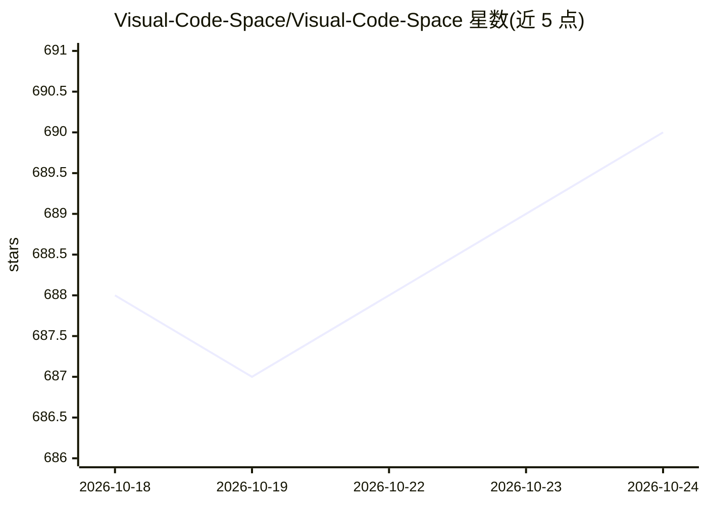

# Visual-Code-Space/Visual-Code-Space

⭐ 691 · Kotlin · GPL-3.0 · 推送 2026-10-21 · [GitHub](https://github.com/Visual-Code-Space/Visual-Code-Space) · [官网](http://visualcodespace.com.br/) · 组织维护

**Android 平台的代码编辑器，支持插件与内置终端**

面向 Android 设备的代码编辑器应用，使用 Kotlin/Jetpack Compose 构建（据仓库主题标签）。功能包括文件浏览、多语言语法高亮（TextMate 文件）、多标签编辑、内置终端模拟器（基于 Termux 相关组件）以及 BeanShell/Java 编写的插件扩展机制。通过 GitHub releases 页面或 Telegram 群组分发 APK。README 未描述具体 AI 功能，尽管仓库主题标签含 ai/ai-code-generator。许可证为 GPL-3.0。

## 筛选速览

| 维度 | 判定 | 备注 |
|---|---|---|
| AI 角色 | `ai-enhanced` | 去掉 AI 部分产品仍成立 |
| 许可风险 | `viral` | GPL-3.0 |
| 部署形态 | `desktop` | 安装包/桌面程序 |
| 模型依赖 | — | README 未给出锁定关系 |
| 硬件要求 | — | 无带数字的原话,不猜 |
| 安装摩擦 | `low` | 无编译、无系统依赖或容器化 |
| 成熟度 | — | 结构信号不足 |

## 能力要点

- 多语言语法高亮与多标签编辑界面
- 内置终端模拟器，可在应用内执行命令
- 支持 BeanShell/Java 自定义插件扩展
- 无广告，APK 从 releases 或 Telegram 群组分发

## 适用场景

- 在 Android 设备上随时编写和浏览代码
- 在应用内终端执行命令行操作
- 通过编写 Java 插件定制编辑器功能

## 场景标签

 · 领域:开发工具/移动 IDE

## 证据(README 行号)

> L29: **Visual Code Space** is a cutting-edge code editor meticulously crafted for Android devices. It

## 星数曲线

2026-10-18 688 → 2026-10-24 690（+2）

---
*卡片 v1 · prompt 1.4 · 生成 2026-10-21 · 置信度 low · 依据 README sha `3db9ce4b003a` · [字段定义](../../DATASET.md)*
