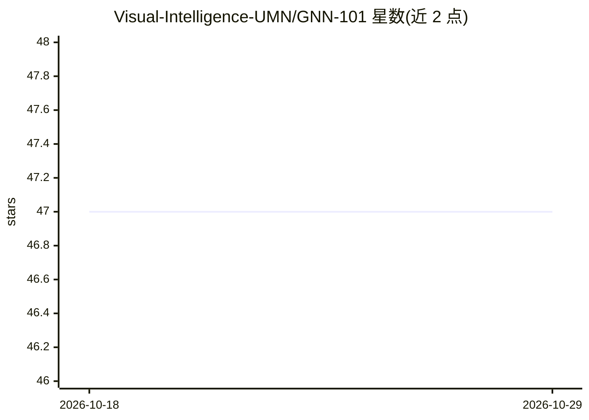

# Visual-Intelligence-UMN/GNN-101

⭐ 47 · TypeScript · 推送 2026-03-10 · [GitHub](https://github.com/Visual-Intelligence-UMN/GNN-101) · [官网](https://visual-intelligence-umn.github.io/GNN-101/) · 组织维护

**在浏览器中交互式学习图神经网络的可视化教育工具**

明尼苏达大学团队开发的教育可视化工具：在网页浏览器中展示图神经网络（GCN）在 MUTAG 化合物数据集上做图分类的逐层计算过程，左侧为图概念教学内容，右侧为模型可视化。提供节点-链接视图与邻接矩阵视图两种互补视角，可在模型概览、层操作、矩阵计算动画等抽象层级间切换，实时查看模型预测。无需安装即可在线使用，本地运行需 Node.js 18+。论文发表于 IEEE TVCG（2025）。

## 筛选速览

| 维度 | 判定 | 备注 |
|---|---|---|
| AI 角色 | `ai-knowledge` | 知识聚合/清单类 |
| 许可风险 | `none` | — |
| 部署形态 | `library` | 以包/库形式分发 |
| 模型依赖 | — | README 未给出锁定关系 |
| 硬件要求 | — | 无带数字的原话,不猜 |
| 安装摩擦 | `low` | 无编译、无系统依赖或容器化 |
| 成熟度 | — | 结构信号不足 |

## 能力要点

- 浏览器中可视化 GCN 在 MUTAG 数据集上的逐层计算与预测
- 节点-链接视图与邻接矩阵视图双视角切换
- 多抽象层级：模型概览、层操作、矩阵计算动画
- 开源且可直接在浏览器运行，无需安装

## 适用场景

- 非 AI 专业学生学习图神经网络的计算原理
- 课堂教学演示 GNN 逐层传播与节点表示学习
- 对照公式与可视化理解邻接矩阵变换

## 场景标签

`教程课程` · 领域:学习与行业

## 证据(README 行号)

> L15:  GNN 101 demo: Interactive interface for learning GNNs. Left panel shows educational content on graph concepts (nod
> L19: **GNN 101** is an educational visualization tool for interactive learning of Graph Neural Networks. It seamlessly i

## 星数曲线

2026-10-18 47 → 2026-10-29 47（+0）

---
*卡片 v1 · prompt 1.4 · 生成 2026-10-25 · 置信度 high · 依据 README sha `116b6a67892c` · [字段定义](../../DATASET.md)*
