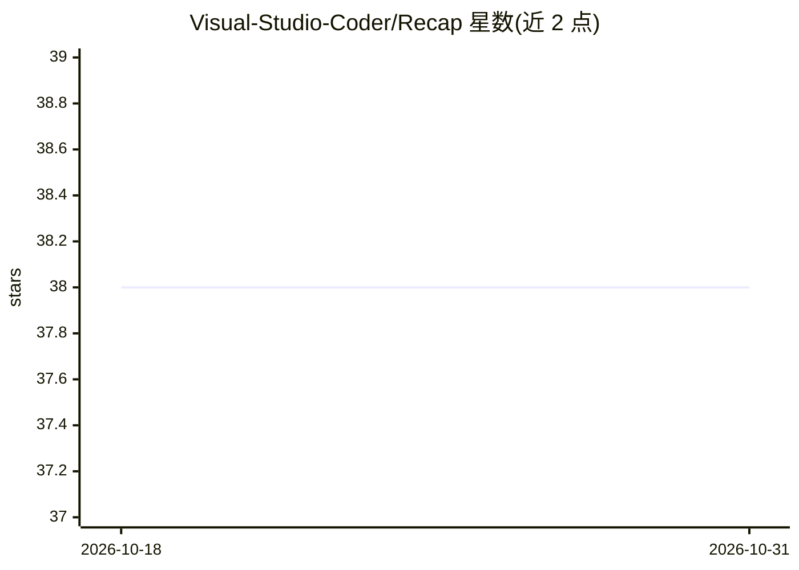

# Visual-Studio-Coder/Recap

⭐ 38 · Swift · Apache-2.0 · 推送 2026-07-30 · [GitHub](https://github.com/Visual-Studio-Coder/Recap) · [官网](https://www.youtube.com/watch?v=HSrOVvkOAQ0) · 个人维护

**学生用的移动端 AI 测验生成应用（iOS/Android）**

Recap 是面向学生的 iOS/Android 应用：用户输入笔记、图片、URL、YouTube 视频链接或纯文本，应用调用 Gemini API 生成个性化测验，支持选择题、多选题与开放式问答（AI 批改），并提供每题解析、成绩反馈、测验历史与分享/重做功能。运行时需用户自行申请并配置免费 Gemini API key，免费账户在 Gemini 2.5 Pro 上有 32K 输入限制。iOS 侧从 App Store 安装或用 Xcode 从源码构建运行。

## 筛选速览

| 维度 | 判定 | 备注 |
|---|---|---|
| AI 角色 | `ai-native` | 本体是模型或模型工具 |
| 许可风险 | `permissive` | Apache-2.0 |
| 部署形态 | `None` |  |
| 模型依赖 | — | README 未给出锁定关系 |
| 硬件要求 | — | 无带数字的原话,不猜 |
| 安装摩擦 | `low` | 无编译、无系统依赖或容器化 |
| 成熟度 | — | 结构信号不足 |

## 能力要点

- 从图片/URL/YouTube/文本多种输入生成测验
- 开放式问答由 AI 批改并给出改进建议
- Explain 按钮解析每个选项的正确/错误原因
- 测验历史：查看、分享、重做与重新生成

## 适用场景

- 把课堂笔记或 PDF 转成测验自测
- 用 YouTube 视频链接生成复习题
- 测验后获得薄弱概念的阅读推荐

## 场景标签

 · 领域:教育/学习应用

## 证据(README 行号)

> L7:  🤖 AI powered quiz generation based on user notes
> L29: 2. Complete the Onboarding process and input your free Gemini API key
> L49: As mentioned previously, Recap prompts Gemini with your input, and it returns a JSON with the quiz info, which Reca

## 星数曲线

2026-10-18 38 → 2026-10-31 38（+0）

---
*卡片 v1 · prompt 1.4 · 生成 2026-10-25 · 置信度 high · 依据 README sha `031ac3593de0` · [字段定义](../../DATASET.md)*
