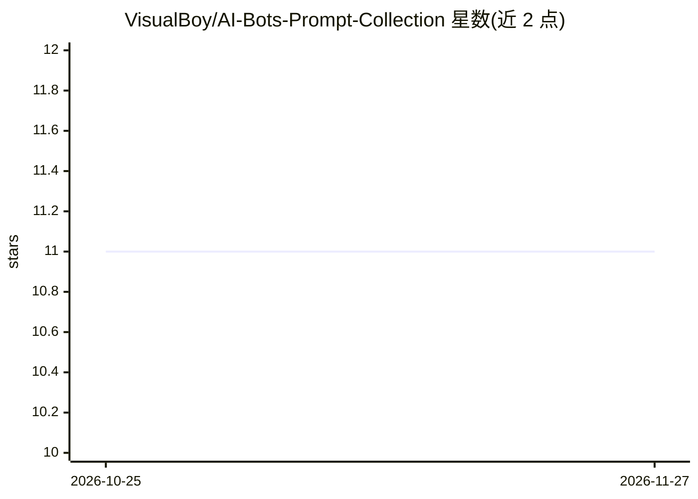

# VisualBoy/AI-Bots-Prompt-Collection

⭐ 11 · NOASSERTION · 推送 2026-04-22 · [GitHub](https://github.com/VisualBoy/AI-Bots-Prompt-Collection) · 个人维护

**为 bolt/cline/cursor 等 AI 编码机器人收集提示词与资源的仓库**

按机器人（bolt、cline、cursor）分目录组织提示词、文档与资源的集合仓库，计划包含逐步设置教程、提示词最佳实践指南、FAQ 与排障文档、原始仓库链接汇编、playground 沙盒示例、YouTube 教程合集及贡献模板。安装方式为 git clone 后浏览 prompts 目录，README 中部分板块以规划性描述呈现。

## 筛选速览

| 维度 | 判定 | 备注 |
|---|---|---|
| AI 角色 | `ai-knowledge` | 知识聚合/清单类 |
| 许可风险 | `none` | NOASSERTION |
| 部署形态 | `None` |  |
| 模型依赖 | — | README 未给出锁定关系 |
| 硬件要求 | — | 无带数字的原话,不猜 |
| 安装摩擦 | `low` | 无编译、无系统依赖或容器化 |
| 成熟度 | — | 结构信号不足 |

## 能力要点

- 按 bot 分目录组织的提示词与文档集合
- 包含提示词最佳实践指南与 FAQ/排障文档规划
- 汇编各 bot 原始仓库与社区资源链接
- 提供 playground 文件夹用于沙盒测试提示词

## 适用场景

- 为 Cursor 或 Cline 查找可复用的系统提示词
- 学习如何为 AI 编码工具编写有效提示词
- 查找 bolt/cline/cursor 的教程与社区资源

## 场景标签

`提示工程` `精选清单` · 领域:Agent 开发

## 证据(README 行号)

> L3: A collection of prompts and resources for various bots (bolt, cline, cursor). The repository is structured to clearl
> L9:  - `prompts/`: Contains prompt files for each bot.

## 星数曲线

2026-10-25 11 → 2026-11-27 11（+0）

---
*卡片 v1 · prompt 1.4 · 生成 2026-11-18 · 置信度 high · 依据 README sha `bfa040b0cb0a` · [字段定义](../../DATASET.md)*
