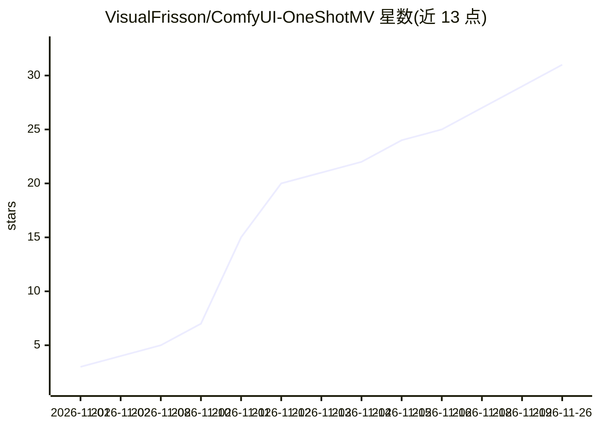

# VisualFrisson/ComfyUI-OneShotMV

⭐ 31 · Python · MIT · 推送 2026-11-20 · [GitHub](https://github.com/VisualFrisson/ComfyUI-OneShotMV) · 个人维护

**ComfyUI 本地音乐视频生成工具：一首歌加一句话产出对嘴型 MV**

以 ComfyUI 自定义节点和 Studio 应用形式提供的本地音乐视频生成工具：读取歌曲并分析节拍、段落与分离人声/鼓轨，用 LTX-2.3 视频模型与 Krea 2 图像模型（文本编码 Gemma 3）根据一句世界观描述生成角色肖像、演唱片段与空镜，SyncNet 评分对嘴型并自动重拍不合格片段，最终按节拍剪辑并叠加鼓驱动的音频反应特效，输出 MP4、EDL 与 Final Cut Pro/Premiere XML。提供 Studio 应用、ComfyUI 工作流（Director 节点）与 Comfy SDK 脚本三种运行方式，全程本地运行开源权重模型。

## 筛选速览

| 维度 | 判定 | 备注 |
|---|---|---|
| AI 角色 | `ai-native` | 本体是模型或模型工具 |
| 许可风险 | `permissive` | MIT |
| 部署形态 | `desktop` | 安装包/桌面程序 |
| 模型依赖 | — | README 未给出锁定关系 |
| 硬件要求 | — | 无带数字的原话,不猜 |
| 安装摩擦 | `medium` | 含编译或系统依赖之一 |
| 成熟度 | — | 结构信号不足 |

## 能力要点

- 歌曲分析驱动分镜规划与按能量级别的剪辑策略
- LTX-2.3 音频到视频生成对嘴型片段，SyncNet 评分自动重拍
- 视觉检查肖像合格性（单人、性别、构图、时代一致性）并重做
- 三种运行方式：Studio 应用、ComfyUI Director 节点、Comfy SDK 命令行

## 适用场景

- 用一首歌和一句世界观描述生成完整对嘴型音乐视频
- 用自己的照片或图片文件夹生成单人演唱视频
- 在 ComfyUI 中以工作流或脚本方式自动化音乐视频制作
- 导出 EDL/XML 到 Premiere Pro 或 DaVinci Resolve 继续剪辑

## 场景标签

`视频生成` · 领域:内容生成

## 证据(README 行号)

> L3: Give OneShot MV a song and one line about the world it lives in. It listens to the song, invents a cast for that wor
> L25: 6. LTX-2.3 turns each portrait into a clip that sings the isolated vocal.
> L57: |The Studio (recommended)|Everyone|An app inside ComfyUI: the brief, the plan, live rendering, the result, post pro

## 星数曲线

2026-11-01 3 → 2026-11-26 31（+28）

---
*卡片 v1 · prompt 1.4 · 生成 2026-11-18 · 置信度 mid · 依据 README sha `a0f5bebdc7bf` · [字段定义](../../DATASET.md)*
