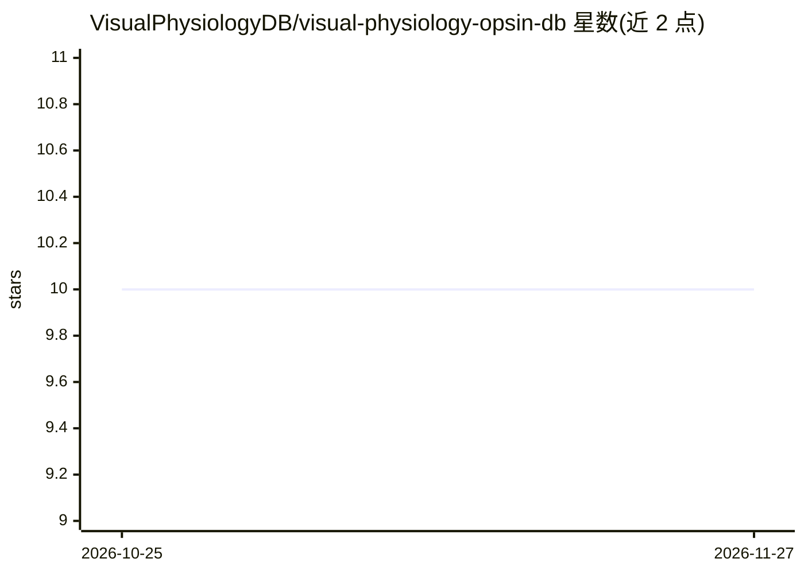

# VisualPhysiologyDB/visual-physiology-opsin-db

⭐ 10 · Jupyter Notebook · GPL-3.0 · 推送 2026-09-09 · [GitHub](https://github.com/VisualPhysiologyDB/visual-physiology-opsin-db) · 组织维护

**视蛋白基因型-表型数据库及λmax预测ML模型**

VPOD 汇编了来自 120+ 篇文献的 1714 条视蛋白基因型及对应最大吸收波长（λmax）表型数据，提供原始 CSV 文件、SQLite 构建流程与多类格式化数据子集；配套 Jupyter notebook 完成从建库到训练回归 ML 模型的完整流程，模型用于预测 λmax 并识别关键氨基酸位点，还提供 ESM2 嵌入训练、系统发育加权交叉验证、缺失值插补对比等子测试结果，以及 Mine-n-Match 工作流和在线查询前端 VPOD Explorer。

## 筛选速览

| 维度 | 判定 | 备注 |
|---|---|---|
| AI 角色 | `ai-knowledge` | 知识聚合/清单类 |
| 许可风险 | `viral` | GPL-3.0 |
| 部署形态 | `None` |  |
| 模型依赖 | — | README 未给出锁定关系 |
| 硬件要求 | — | 无带数字的原话,不猜 |
| 安装摩擦 | `low` | 无编译、无系统依赖或容器化 |
| 成熟度 | — | 结构信号不足 |

## 能力要点

- 1714 条视蛋白基因型-λmax表型数据，来自 120+ 篇文献
- 提供 SQLite 原始库文件与无需 MySQL/序列比对的格式化数据子集
- 回归 ML 模型预测 λmax 并检验非加性突变效应
- 配套 OPTICS 命令行/在线预测工具与 VPOD Explorer 前端

## 适用场景

- 查询和下载视蛋白 λmax 表型数据
- 用训练好的模型预测视蛋白光谱敏感性
- 复现或扩展基因型-表型关联的机器学习分析

## 场景标签

`科研工具` · 领域:学习与行业

## 证据(README 行号)

> L4: _A database of opsins and machine-learning models to predict λmax phenotypes_
> L13: * We introduce the Visual Physiology Opsin Database, a newly compiled database for all heterologously expressed, an
> L15: * **VPOD_1.3** contains 1714 unique opsin genotypes and corresponding λmax phenotypes collected across all animals 

## 星数曲线

2026-10-25 10 → 2026-11-27 10（+0）

---
*卡片 v1 · prompt 1.4 · 生成 2026-11-20 · 置信度 high · 依据 README sha `24ac47e994a9` · [字段定义](../../DATASET.md)*
