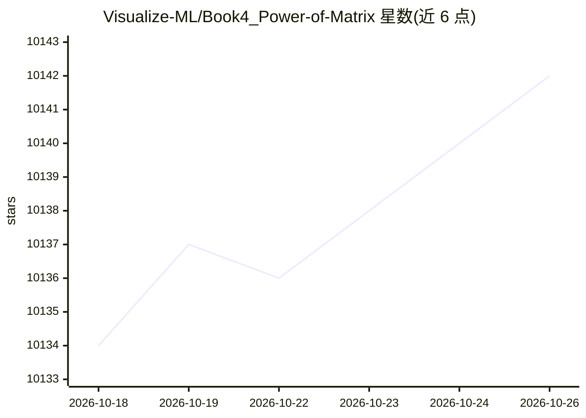

# Visualize-ML/Book4_Power-of-Matrix

⭐ 10,142 · Jupyter Notebook · 推送 2026-05-01 · [GitHub](https://github.com/Visualize-ML/Book4_Power-of-Matrix) · 组织维护 · 中文 README

**《矩阵力量》开源数学教材：线性代数到机器学习**

鸢尾花书系列的开源数学书籍《矩阵力量》，内容从线性代数（矩阵加减乘除、矩阵分解）延伸到机器学习相关数学基础。README 仅提供本书及系列其他分册（《统计至简》《数学要素》）的购书五折入口链接，声明开源资源永久有效，并设有纠错赠书机制。仓库以书籍章节与配套笔记本形式组织，面向自学者与机器学习学习者提供数学基础材料。

## 筛选速览

| 维度 | 判定 | 备注 |
|---|---|---|
| AI 角色 | `ai-knowledge` | 知识聚合/清单类 |
| 许可风险 | `none` | — |
| 部署形态 | `None` |  |
| 模型依赖 | — | README 未给出锁定关系 |
| 硬件要求 | — | 无带数字的原话,不猜 |
| 安装摩擦 | `low` | 无编译、无系统依赖或容器化 |
| 成熟度 | — | 结构信号不足 |

## 能力要点

- 开源数学书籍，覆盖线性代数与矩阵分解
- 鸢尾花书系列：从加减乘除到机器学习
- 纠错赠书的社区协作机制

## 适用场景

- 系统学习机器学习所需的线性代数与矩阵知识
- 配合鸢尾花书系列自学数学基础

## 场景标签

`教程课程` · 领域:学习与行业

## 证据(README 行号)

> L10: 看个人情况，开源资源，永久有效哈。

## 星数曲线

2026-10-18 10,134 → 2026-10-26 10,142（+8）

---
*卡片 v1 · prompt 1.4 · 生成 2026-10-20 · 置信度 mid · 依据 README sha `e09410b99c8d` · [字段定义](../../DATASET.md)*
