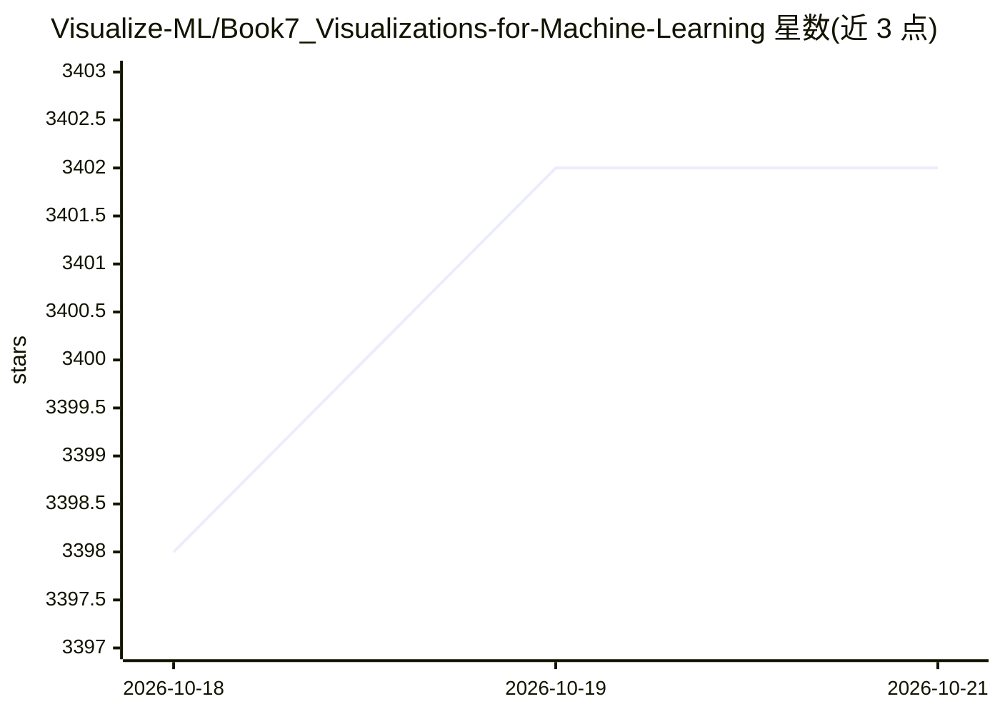

# Visualize-ML/Book7_Visualizations-for-Machine-Learning

⭐ 3,402 · Jupyter Notebook · 推送 2026-05-01 · [GitHub](https://github.com/Visualize-ML/Book7_Visualizations-for-Machine-Learning) · 组织维护 · 中文 README

**《机器学习》鸢尾花书系列开源书籍仓库（数学至机器学习）**

Visualize-ML 鸢尾花书系列的第七册《机器学习》开源仓库，与《统计至简》《数学要素》《矩阵力量》等同系列书籍相关联，README 提供同系列书籍的五折购书入口与知乎链接，并说明开源资源永久有效、欢迎纠错（纠错多者可获赠书）。仓库主题标签覆盖线性代数、矩阵、贝叶斯、机器学习算法与数据科学。README 未展示本书的具体章节内容、安装或运行方式。

## 筛选速览

| 维度 | 判定 | 备注 |
|---|---|---|
| AI 角色 | `ai-knowledge` | 知识聚合/清单类 |
| 许可风险 | `none` | — |
| 部署形态 | `None` |  |
| 模型依赖 | — | README 未给出锁定关系 |
| 硬件要求 | — | 无带数字的原话,不猜 |
| 安装摩擦 | `low` | 无编译、无系统依赖或容器化 |
| 成熟度 | — | 结构信号不足 |

## 能力要点

- 鸢尾花书系列（从加减乘除到机器学习）开源仓库
- 同系列《统计至简》《数学要素》《矩阵力量》的知乎入口
- 开源资源永久有效，欢迎纠错并可获赠书

## 适用场景

- 系统学习从数学基础到机器学习的知识
- 查找同系列数学/机器学习书籍资源
- 参与纠错获取赠书

## 场景标签

`教程课程` · 领域:学习与行业

## 证据(README 行号)

> L1: 《统计至简》五折入口：
> L5: 《数学要素》五折入口：
> L13: 看个人情况，开源资源，永久有效哈。

## 星数曲线

2026-10-18 3,398 → 2026-10-21 3,402（+4）

---
*卡片 v1 · prompt 1.4 · 生成 2026-10-20 · 置信度 mid · 依据 README sha `f075283dd07f` · [字段定义](../../DATASET.md)*
