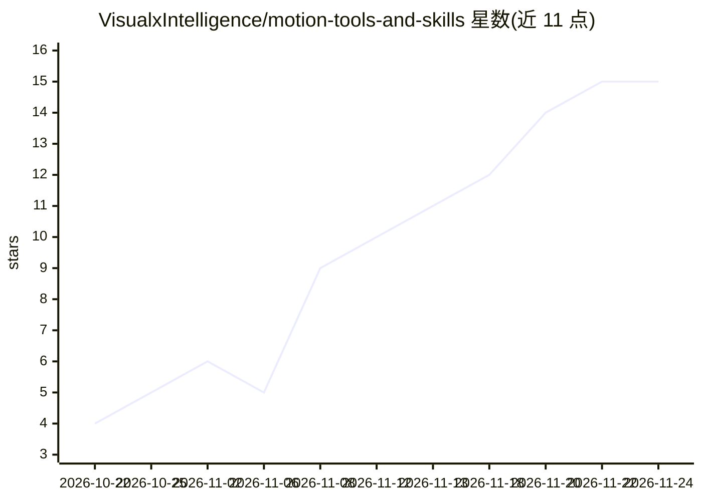

# VisualxIntelligence/motion-tools-and-skills

⭐ 15 · Python · MIT · 推送 2026-11-22 · [GitHub](https://github.com/VisualxIntelligence/motion-tools-and-skills) · 个人维护

**为 AI agent 做动态设计提供的技能、提示词与工具集合**

面向 Claude Code agent 的动态图形创作资源库：收录约 20 个 Claude Code skills（动态字体、三维产品影片、解释视频、Blender 建模等）、品牌/字体/设计系统生成、电影风格与运动设计提示词，以及无头渲染、音画同步检查、Mixamo 重定向等工具和 WebGPU/three.js 起步模板。素材分七次从多个开源项目收集，逐项保留上游许可证并附 NOTES.md 说明。使用方式为将技能文件夹复制或软链到 .claude/skills 目录。

## 筛选速览

| 维度 | 判定 | 备注 |
|---|---|---|
| AI 角色 | `ai-knowledge` | 知识聚合/清单类 |
| 许可风险 | `permissive` | MIT |
| 部署形态 | `None` |  |
| 模型依赖 | — | README 未给出锁定关系 |
| 硬件要求 | — | 无带数字的原话,不猜 |
| 安装摩擦 | `low` | 无编译、无系统依赖或容器化 |
| 成熟度 | — | 结构信号不足 |

## 能力要点

- 约 20 个 Claude Code skills 覆盖动态字体、影片、三维与设计原理
- tools/ 提供无头渲染、节拍分析、音画同步检查等辅助工具
- 51 个电影风格提示词与 104+ 策展动态设计提示词
- 所有收录素材保留上游许可证并附 NOTES.md 变更说明

## 适用场景

- 用 Claude Code 生成动态字体短片和解释视频
- 从专利、照片或 CAD 生成 Blender 产品影片
- 给 agent 项目补充渲染、音频与素材管线工具

## 场景标签

 · 领域:创意设计/动态图形

## 证据(README 行号)

> L3: Tools, agent skills, prompts and starters for making motion graphics with AI agents (Claude Code). The focus is code
> L87: Copy a skill folder into `%USERPROFILE%\.claude\skills\` (Windows) or symlink it into `~/.claude/skills/` (macOS, L

## 星数曲线

2026-10-22 4 → 2026-11-24 15（+11）

---
*卡片 v1 · prompt 1.4 · 生成 2026-11-18 · 置信度 high · 依据 README sha `c8876d813cf1` · [字段定义](../../DATASET.md)*
