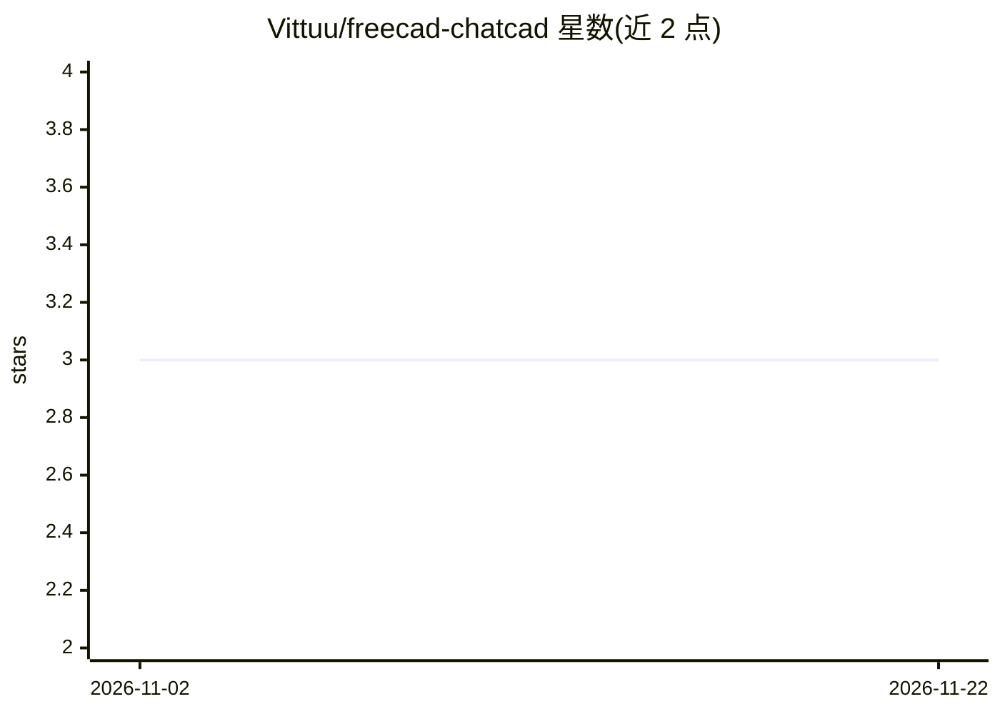

# Vittuu/freecad-chatcad

⭐ 3 · Python · LGPL-2.1 · 推送 2026-10-12 · [GitHub](https://github.com/Vittuu/freecad-chatcad) · [官网](https://vittuu-portfolio-ai.vercel.app) · 个人维护

**FreeCAD 侧边 AI 面板：对话方式生成参数化模型**

以 FreeCAD 插件形式提供的 agent 侧边面板：用户描述零件、在 3D 视图中选中面/边或涂鸦标注，agent 生成带 Parametros 参数表的参数化 FreeCAD 文档。支持四种 provider——Claude Code、Codex、Antigravity 三种 CLI（复用现有登录，经 freecad-mcp 驱动 FreeCAD），以及经 Ollama/OpenAI 兼容服务器的本地模型（面板内自建 agent 循环，固定 4 工具集）。含变更前备份、失败回滚、单实体有效性自动检查等安全机制。状态 alpha，界面为巴西葡萄牙语，本地模型经实测仅能完成简单零件。

## 筛选速览

| 维度 | 判定 | 备注 |
|---|---|---|
| AI 角色 | `ai-native` | 本体是模型或模型工具 |
| 许可风险 | `viral` | LGPL-2.1 |
| 部署形态 | `desktop` | 安装包/桌面程序 |
| 模型依赖 | local-ok | 支持本地模型 |
| 硬件要求 | — | 无带数字的原话,不猜 |
| 安装摩擦 | `low` | 无编译、无系统依赖或容器化 |
| 成熟度 | `idea` | |

## 能力要点

- 点选 3D 视图（面/边/点）或涂鸦截图随消息发送给 agent
- 默认参数化：尺寸存于带别名的 Parametros 电子表格
- 四 provider：三个 CLI 复用现有登录，本地路径不离开本机网络
- 备份、逐步撤销、失败回滚与单实体有效性自动检查

## 适用场景

- 在 FreeCAD 中用自然语言描述生成参数化零件
- 选中已有模型的某个面，让 agent 做局部修改
- 用本地模型在不联网的机器上建模简单零件

## 场景标签

`编码 Agent` · 领域:编码与开发

## 证据(README 行号)

> L3: An AI agent side panel for FreeCAD. Describe a part, point at a face, or scribble on the 3D view, and an agent model
> L17: - **Four providers:** Claude Code, Codex and Antigravity use **your existing CLI login/subscription** (no API keys 

## 星数曲线

2026-11-02 3 → 2026-11-22 3（+0）

---
*卡片 v1 · prompt 1.4 · 生成 2026-11-22 · 置信度 high · 依据 README sha `99e0a8500653` · [字段定义](../../DATASET.md)*
