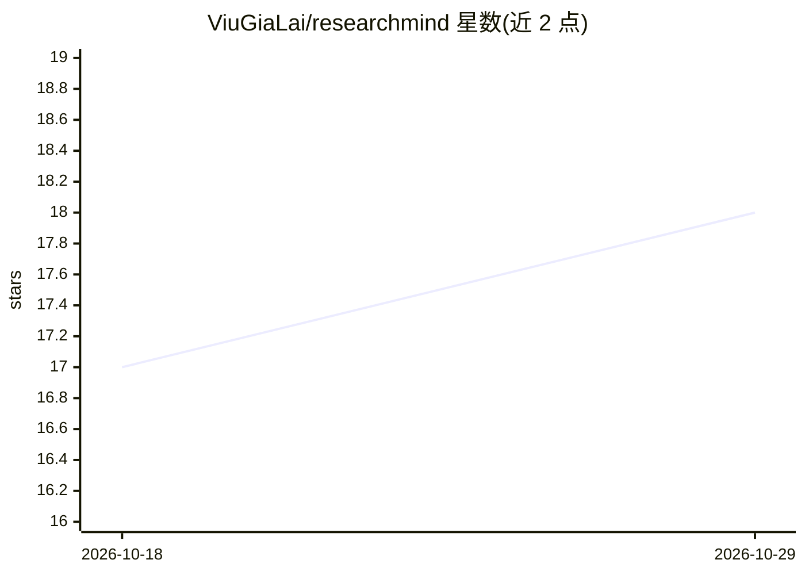

# ViuGiaLai/researchmind

⭐ 18 · Python · MIT · 推送 2026-07-29 · [GitHub](https://github.com/ViuGiaLai/researchmind) · [官网](https://researchmind.pages.dev) · 个人维护

**本地优先的学术研究 AI 助手：论文管理与 RAG 问答全离线**

面向科研人员的桌面应用（Tauri + React + FastAPI）：管理论文库（集合/标签/高亮/笔记），混合检索（BM25 FTS5 + ChromaDB 向量 + Cross-Encoder 重排），支持单篇或多篇论文的 RAG 对话、批评性分析、多 AI 人设辩论与 DOI 核验（OpenAlex/Crossref/Semantic Scholar），并可生成 7 段式文献综述导出 DOCX/HTML/Markdown。拖拽导入 PDF/DOCX/EPUB 等格式自动解析与索引，含 RapidOCR。数据全部留在本机，可通过 llama-server 加本地 GGUF 模型完全离线运行，云 LLM 为可选项。

## 筛选速览

| 维度 | 判定 | 备注 |
|---|---|---|
| AI 角色 | `ai-native` | 本体是模型或模型工具 |
| 许可风险 | `permissive` | MIT |
| 部署形态 | `library` | 以包/库形式分发 |
| 模型依赖 | local-ok | 支持本地模型 |
| 硬件要求 | — | 无带数字的原话,不猜 |
| 安装摩擦 | `low` | 无编译、无系统依赖或容器化 |
| 成熟度 | — | 结构信号不足 |

## 能力要点

- BM25 + 向量 + Cross-Encoder 的混合语义检索
- RAG 对话、批评分析、多 AI 人设辩论与 DOI 核验
- 7 段式文献综述生成，导出 DOCX/HTML/Markdown
- 本地优先，支持 llama-server + 本地 GGUF 完全离线

## 适用场景

- 科研人员在本机管理论文库并做语义检索
- 与单篇或多篇论文对话并核验其中的声明
- 自动生成结构化文献综述
- Zotero 用户同步已有文献元数据

## 场景标签

`科研工具` `RAG` `知识库管理` `语义搜索` · 领域:知识与检索

## 证据(README 行号)

> L8:  Local-First AI Research Assistant for Academics
> L25: ### 🤖 AI Chat & RAG
> L100: - **Fully offline** capable (using llama-server with local GGUF models)

## 星数曲线

2026-10-18 17 → 2026-10-29 18（+1）

---
*卡片 v1 · prompt 1.4 · 生成 2026-10-29 · 置信度 mid · 依据 README sha `00047d099381` · [字段定义](../../DATASET.md)*
