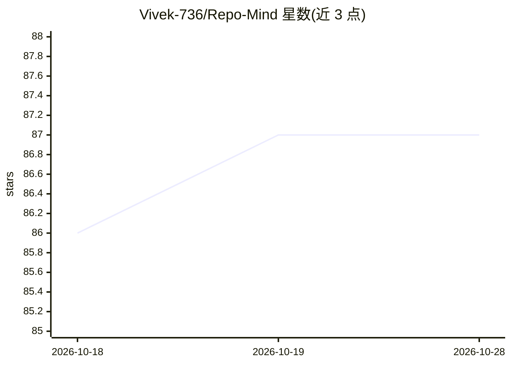

# Vivek-736/Repo-Mind

⭐ 87 · TypeScript · MIT · 推送 2026-06-17 · [GitHub](https://github.com/Vivek-736/Repo-Mind) · [官网](https://repo-mind-sigma.vercel.app) · 个人维护

**面向开发者的 GitHub 仓库 AI 文档生成与代码问答平台**

RepoMind 是一个基于 Next.js 的 Web 应用：接入 GitHub 账号后，用户选择仓库或粘贴公开 URL，系统通过 Inngest 后台流水线解析项目架构、目录结构、依赖与 API，用 Gemini 2.0 Flash 生成文档，并基于 Pinecone 向量检索提供针对该代码库的自然语言问答（RAG）。另提供健康评分（可维护性、文档覆盖、安全等维度）与活动监控。自部署需 Node.js 20+、PostgreSQL（Neon）、Pinecone 与 Gemini API key。

## 筛选速览

| 维度 | 判定 | 备注 |
|---|---|---|
| AI 角色 | `ai-native` | 本体是模型或模型工具 |
| 许可风险 | `permissive` | MIT |
| 部署形态 | `library` | 以包/库形式分发 |
| 模型依赖 | — | README 未给出锁定关系 |
| 硬件要求 | — | 无带数字的原话,不猜 |
| 安装摩擦 | `low` | 无编译、无系统依赖或容器化 |
| 成熟度 | — | 结构信号不足 |

## 能力要点

- 解析仓库架构并自动生成系统架构图、API 浏览器与依赖关系图，支持 Markdown 导出
- 基于 Pinecone 向量检索的代码库问答（Ask RepoMind）
- 代码库健康评分：可维护性、文档覆盖、安全漏洞、测试覆盖等维度
- Inngest 驱动的异步分析流水线，带重试与实时进度

## 适用场景

- 接手陌生仓库时快速生成本地化文档与架构说明
- 用自然语言向代码库提问定位实现与认证流程
- 追踪仓库技术债与文档覆盖情况

## 场景标签

`RAG` · 领域:知识与检索

## 证据(README 行号)

> L7: **Transform Your Codebase into Intelligent Documentation in Seconds**
> L36: Powered by Gemini 2.0 Flash for lightning-fast architectural parsing and reasoning.
> L74: #### 💬 **Ask RepoMind (RAG)**

## 星数曲线

2026-10-18 86 → 2026-10-28 87（+1）

---
*卡片 v1 · prompt 1.4 · 生成 2026-10-23 · 置信度 high · 依据 README sha `89aadadd0f1a` · [字段定义](../../DATASET.md)*
