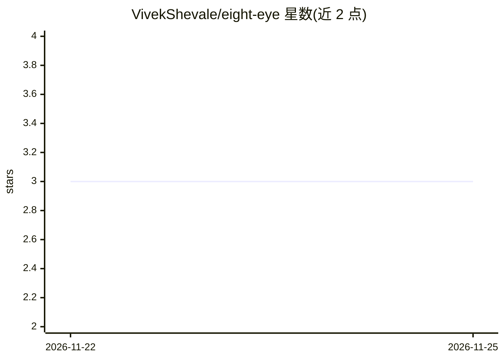

# VivekShevale/eight-eye

⭐ 3 · Python · MIT · 推送 2026-11-20 · [GitHub](https://github.com/VivekShevale/eight-eye) · 个人维护

**为 Claude Code 提供后端开发规范的 Agent 技能集**

eight-eye 是面向 Claude Code 的 Agent Skills 集合，按领域拆分技能：shared 标准类（silk）覆盖后端结构、分层、错误处理、日志、配置、安全与请求/响应模式，以及 SQL（PostgreSQL/MySQL/SQLite）、MongoDB；框架类（spider）覆盖 FastAPI、Flask、Django REST Framework、Node.js/Express 5、RAG 流水线与 MCP 服务器/客户端。安装方式为 git clone 后复制到 Claude Code 技能目录，或从 Releases 下载 zip 上传至 claude.ai。spider 类技能依赖对应的 silk 技能，需搭配安装。

## 筛选速览

| 维度 | 判定 | 备注 |
|---|---|---|
| AI 角色 | `ai-knowledge` | 知识聚合/清单类 |
| 许可风险 | `permissive` | MIT |
| 部署形态 | `desktop` | 安装包/桌面程序 |
| 模型依赖 | — | README 未给出锁定关系 |
| 硬件要求 | — | 无带数字的原话,不猜 |
| 安装摩擦 | `low` | 无编译、无系统依赖或容器化 |
| 成熟度 | — | 结构信号不足 |

## 能力要点

- 每个领域一个技能：silk 共享标准 + spider 框架专用技能
- 覆盖 FastAPI/Flask/Django/Express/MongoDB/SQL/RAG/MCP 九个技能
- 支持 Claude Code 与 claude.ai 两种安装途径
- spider 技能建立在 silk 标准之上，需搭配安装

## 适用场景

- 让 Claude Code 按统一规范生成后端代码
- 在 claude.ai 中上传框架技能辅助开发
- 为 RAG 与 MCP 相关功能开发提供标准参考

## 场景标签

`编码 Agent` · 领域:编码与开发

## 证据(README 行号)

> L3: Agent Skills for Claude Code: production-grade code standards, one skill per area.
> L25: **Claude Code**: copy the skills you want into your skills folder:

## 星数曲线

2026-11-22 3 → 2026-11-25 3（+0）

---
*卡片 v1 · prompt 1.4 · 生成 2026-11-22 · 置信度 high · 依据 README sha `70f789a870dc` · [字段定义](../../DATASET.md)*
