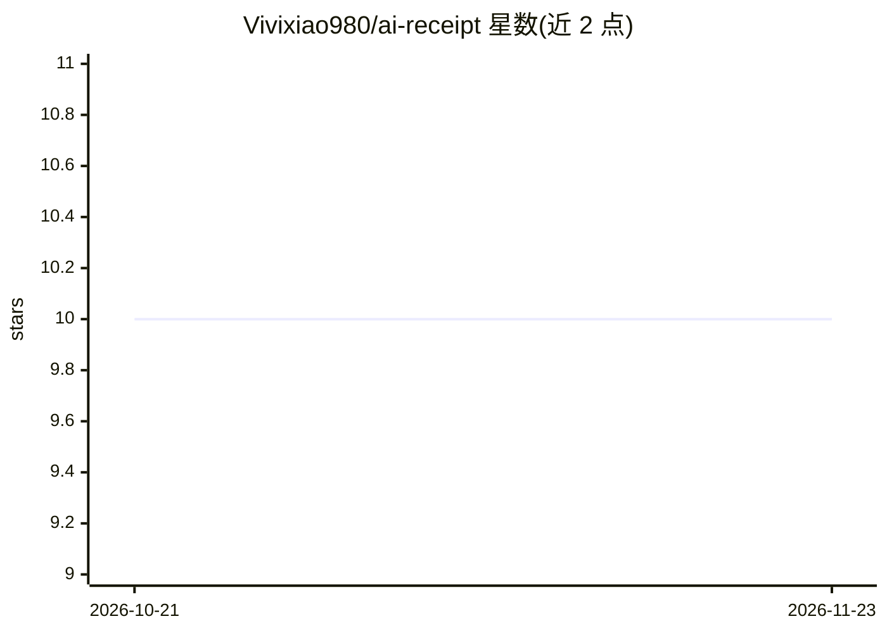

# Vivixiao980/ai-receipt

⭐ 10 · HTML · 推送 2026-07-13 · [GitHub](https://github.com/Vivixiao980/ai-receipt) · [官网](https://today-not-wasted.vercel.app/) · 个人维护 · 中文 README

**为 AI 协作任务生成老板视角复盘小票的 Codex Skill**

以 Codex Skill 形式安装的复盘工具：任务结束后读取本地 Codex 任务日志，生成包含 Token 用量、API 等价费用估算、可观察工作路径、投入产出分析、可复用 SOP 与下一次派活提示词的 HTML 小票，并附带 Markdown/JSON/纯文本证据文件便于交接。默认仅本地读取日志、生成本地文件，不展示隐藏思维链，需在任务结束后主动调用，未配置完成钩子时不会自动打票。作者自述为正在迭代的原创实验，数字为粗略估算而非精确财务统计。

## 筛选速览

| 维度 | 判定 | 备注 |
|---|---|---|
| AI 角色 | `ai-native` | 本体是模型或模型工具 |
| 许可风险 | `none` | — |
| 部署形态 | `None` |  |
| 模型依赖 | — | README 未给出锁定关系 |
| 硬件要求 | — | 无带数字的原话,不猜 |
| 安装摩擦 | `low` | 无编译、无系统依赖或容器化 |
| 成熟度 | `idea` | |

## 能力要点

- 生成可浏览、打印、保存为图片的 HTML 复盘小票
- Token 用量与 API 等价费用估算、基于日志的工作路径还原
- 输出可复用 SOP、任务记忆、踩坑提醒与下一次派活提示词
- 同时产出 Markdown、JSON 和纯文本证据材料

## 适用场景

- AI 编码任务结束后复盘投入产出与沟通问题
- 把一次成功的 AI 协作沉淀为可复用的 SOP
- 生成周报或交接用的任务证据材料

## 场景标签

`AI 写作` · 领域:内容生成

## 证据(README 行号)

> L48: Skill 会自动读取最近任务的可用日志，在桌面生成一个完整复盘文件夹，并返回可点击的 HTML 小票。
> L93: - Skill 默认只在本地读取 Codex 任务日志并生成本地文件。
> L100: 这是一个正在迭代的原创实验，重点不是把每个数字算得像财务系统一样精确，而是帮助人重新获得对 AI 项目的理解、复盘与管理能力。

## 星数曲线

2026-10-21 10 → 2026-11-23 10（+0）

---
*卡片 v1 · prompt 1.4 · 生成 2026-11-20 · 置信度 high · 依据 README sha `1d602635fc27` · [字段定义](../../DATASET.md)*
