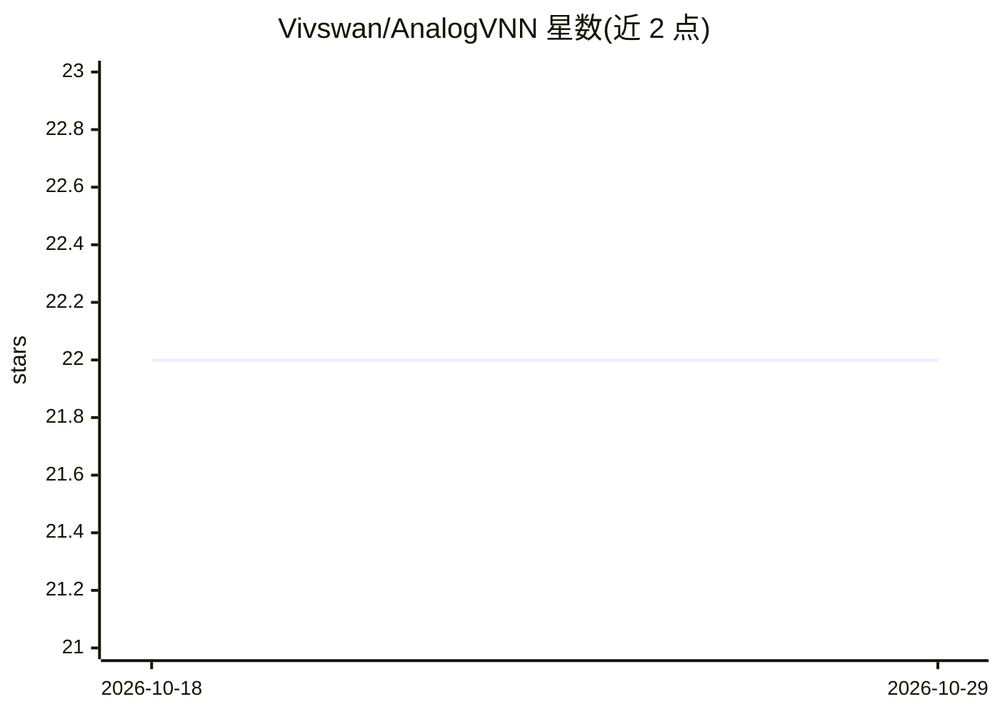

# Vivswan/AnalogVNN

⭐ 22 · Python · NOASSERTION · 推送 2026-01-19 · [GitHub](https://github.com/Vivswan/AnalogVNN) · [官网](https://analogvnn.readthedocs.io) · 个人维护

**模拟光子模拟神经网络效应的 PyTorch 框架，供研究者建模优化**

基于 PyTorch 的模拟框架，用于仿真光子神经网络加速器中的光电噪声、有限精度与信号归一化效应。沿用 PyTorch 层结构设计，可用数行代码将多数数字神经网络模型转换为模拟对应版本；论文中训练了至多 9 层、约 170 万参数的线性与卷积网络。面向研究光电模拟神经网络的研究者与开发者，通过 pip 安装，提供 Colab 笔记本与示例代码。

## 筛选速览

| 维度 | 判定 | 备注 |
|---|---|---|
| AI 角色 | `ai-ecosystem` | LLM/agent 周边工具 |
| 许可风险 | `permissive` | NOASSERTION |
| 部署形态 | `library` | 以包/库形式分发 |
| 模型依赖 | — | README 未给出锁定关系 |
| 硬件要求 | — | 无带数字的原话,不猜 |
| 安装摩擦 | `low` | 无编译、无系统依赖或容器化 |
| 成熟度 | — | 结构信号不足 |

## 能力要点

- 仿真光电噪声、有限精度与信号归一化效应
- 沿用 PyTorch 层结构，数行代码转换数字模型为模拟版本
- 论文中训练至多 9 层、约 170 万参数的网络
- 提供示例代码与 Colab 演示笔记本

## 适用场景

- 研究噪声、精度与归一化对模拟光子网络精度的影响
- 将已有 PyTorch 数字模型转换为模拟对应版本
- 训练与优化线性及卷积模拟神经网络

## 场景标签

 · 领域:AI 框架/光子计算

## 证据(README 行号)

> L43: **AnalogVNN** is a simulation framework built on PyTorch which can simulate the effects of
> L49: structure design present in PyTorch, the AnalogVNN framework allows users to convert most

## 星数曲线

2026-10-18 22 → 2026-10-29 22（+0）

---
*卡片 v1 · prompt 1.4 · 生成 2026-10-27 · 置信度 high · 依据 README sha `0654568f0045` · [字段定义](../../DATASET.md)*
