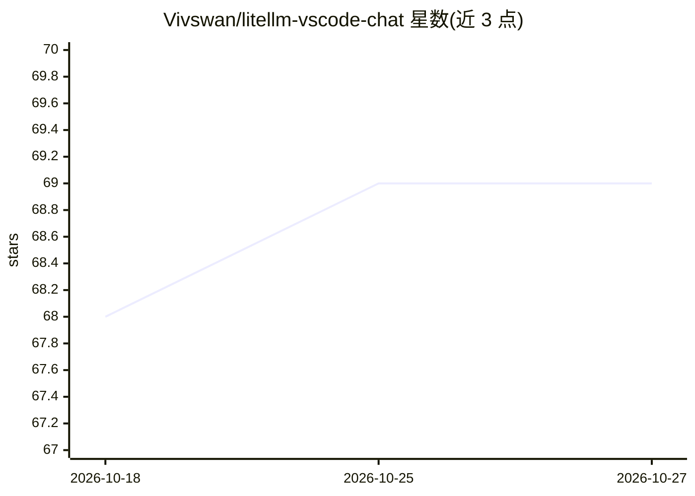

# Vivswan/litellm-vscode-chat

⭐ 69 · TypeScript · NOASSERTION · 推送 2026-10-26 · [GitHub](https://github.com/Vivswan/litellm-vscode-chat) · [官网](https://marketplace.visualstudio.com/items?itemName=vivswan.litellm-vscode-chat) · 个人维护

**让 GitHub Copilot Chat 通过 LiteLLM 使用 100+ LLM 的 VS Code 扩展**

VS Code 扩展，为 GitHub Copilot Chat 接入 LiteLLM 代理服务器，使聊天可用 100+ LLM（OpenAI、Anthropic、Google、AWS、Azure 等）。支持多服务器连接与模型聚合、cheapest/fastest 自动选路、多模态输入输出、流式与函数调用、可选的 FIM 内联补全、提交信息生成与快捷修复。提供服务器/模型/设置面板与设置导入导出。要求 VS Code 1.136.0+、已安装并登录 Copilot Chat、有运行中的 LiteLLM 代理；从 VS Code Marketplace 安装，开发可从源码构建。

## 筛选速览

| 维度 | 判定 | 备注 |
|---|---|---|
| AI 角色 | `ai-ecosystem` | LLM/agent 周边工具 |
| 许可风险 | `none` | NOASSERTION |
| 部署形态 | `None` |  |
| 模型依赖 | — | README 未给出锁定关系 |
| 硬件要求 | — | 无带数字的原话,不猜 |
| 安装摩擦 | `low` | 无编译、无系统依赖或容器化 |
| 成熟度 | — | 结构信号不足 |

## 能力要点

- 通过 LiteLLM 统一 API 在 Copilot Chat 中使用 100+ LLM
- 多服务器连接与模型聚合，cheapest/fastest 自动选路
- 可选 FIM 内联补全、提交信息生成、快捷修复等附加功能
- 服务器/模型/设置仪表盘与设置导入导出

## 适用场景

- 在 VS Code 聊天中改用自建 LiteLLM 网关上的模型
- 聚合多个 LiteLLM 服务器并按价格或速度自动选路
- 用自有代理模型做内联补全和提交信息生成

## 场景标签

`模型网关` `代码生成` · 领域:Agent 开发

## 证据(README 行号)

> L11: Use 100+ LLMs in VS Code with GitHub Copilot Chat powered by LiteLLM.
> L31: - LiteLLM proxy running (self-hosted or cloud)
> L36: 1. Install the extension from the VS Code Marketplace

## 星数曲线

2026-10-18 68 → 2026-10-27 69（+1）

---
*卡片 v1 · prompt 1.4 · 生成 2026-10-24 · 置信度 high · 依据 README sha `87f9e1b19d74` · [字段定义](../../DATASET.md)*
