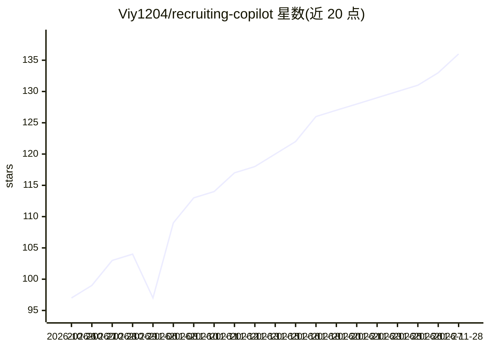

# Viy1204/recruiting-copilot

⭐ 136 · JavaScript · MIT · 推送 2026-11-27 · [GitHub](https://github.com/Viy1204/recruiting-copilot) · 个人维护 · 中文 README

**给 HR 和猎头的 AI 招聘工作流：寻源、初筛、台账与日报**

以 Agent Skills 形式运行的招聘流程集合：先用 recruit-grill 逐岗梳理硬门槛与命脉技能生成 JD 和寻源笔记，再通过 recruit-daily 每日驱动 BOSS 直聘与猎聘双平台寻源、按授权联系候选并更新台账与日报，另含人才盘点、简历评估、面试安排与本地网页工作台。数据以热冷分离结构保存在用户独立工作区（CONTEXT.md、CSV 台账、日志），平台操作统一经 boss/liepin CLI 执行，对外动作默认需人工确认。依赖 Node.js ≥22 与可登录的招聘平台账号。

## 筛选速览

| 维度 | 判定 | 备注 |
|---|---|---|
| AI 角色 | `ai-native` | 本体是模型或模型工具 |
| 许可风险 | `permissive` | MIT |
| 部署形态 | `library` | 以包/库形式分发 |
| 模型依赖 | locked-api |  |
| 硬件要求 | — | 无带数字的原话,不猜 |
| 安装摩擦 | `low` | 无编译、无系统依赖或容器化 |
| 成熟度 | — | 结构信号不足 |

## 能力要点

- 8 个 Skill 覆盖岗位梳理、双平台寻源初筛、人才盘点、简历评估、面试安排与看板
- 平台操作统一经 boss/liepin CLI，联系与外发动作默认逐轮人工授权
- 热冷分离工作区：CONTEXT.md 薄入口、CSV 台账、变更留痕与寻源日志
- 支持 Claude Code、Codex、DeepSeek Harness 等多种 AI 宿主工具

## 适用场景

- 每天让 AI 处理 BOSS 直聘和猎聘的未读人选并初筛跟进
- 新开岗位时梳理 JD、硬门槛与首轮搜索词
- 批量评估收到的简历并并入统一候选台账
- 用本地看板跟进候选阶段和待确认事项

## 场景标签

`工作流自动化` · 领域:效率与自动化

## 证据(README 行号)

> L3: 给 HR 和猎头用的一套 AI 招聘工作流。先逐岗梳理真实要求，再做 BOSS 直聘与猎聘双平台寻源、简历初筛和经授权的联系，最后补齐候选台账、档案与日报。收到外部简历、需要深度人才盘点或安排面试时，也有对应流程。
> L5: 支持 Claude Code、Codex、WorkBuddy、Qoder、MiniMax Code、ZCode 等能读取项目文件的 AI 工具。招聘标准、候选台账和面试档案保存在你自己的工作区，换工具也能接着做。
> L200: |recruit-daily `/recruiting-copilot:recruit-daily`|日常双平台招聘。“处理今天的招聘”|未处理事项、搜索与推荐初筛、经授权的联系结果、候选台账与档案、日报、关键词回填|

## 星数曲线

2026-10-26 97 → 2026-11-28 136（+39）

---
*卡片 v1 · prompt 1.4 · 生成 2026-11-28 · 置信度 high · 依据 README sha `a6a0c2a15292` · [字段定义](../../DATASET.md)*
