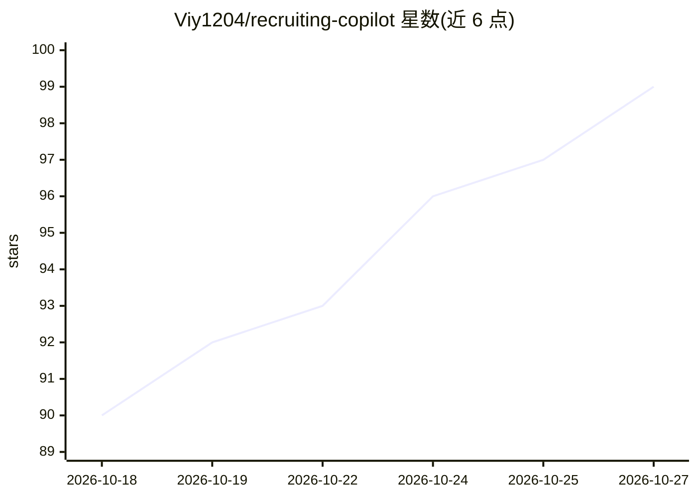

# Viy1204/recruiting-copilot

⭐ 99 · JavaScript · MIT · 推送 2026-10-26 · [GitHub](https://github.com/Viy1204/recruiting-copilot) · 个人维护 · 中文 README

**给 HR/猎头的 AI 招聘工作流：寻源初筛到台账日报全流程**

面向 HR 与猎头的 AI 招聘副驾：通过访谈式梳理岗位初筛标准，接入 Boss直聘与猎聘双通道每日寻源、初筛、打招呼、约面试，并维护候选人台账与日报，另含市场人才盘点与简历评估（含从飞书邮箱收取简历附件）。以 7 个 agent skill 形式提供，可装为 Claude Code 插件或 DeepSeek Harness 插件，也可配合任何读取 AGENTS.md 的 AI 编程助手使用。通过 boss-cli / liepin-cli 驱动 Chrome（CDP）操作平台页面；本地文件为唯一事实源。限制：账号安全规则要求不用无头模式（有被平台风控限制登录的实测记录），对外不可逆动作默认需人工确认。

## 筛选速览

| 维度 | 判定 | 备注 |
|---|---|---|
| AI 角色 | `ai-native` | 本体是模型或模型工具 |
| 许可风险 | `permissive` | MIT |
| 部署形态 | `library` | 以包/库形式分发 |
| 模型依赖 | — | README 未给出锁定关系 |
| 硬件要求 | — | 无带数字的原话,不猜 |
| 安装摩擦 | `low` | 无编译、无系统依赖或容器化 |
| 成熟度 | — | 结构信号不足 |

## 能力要点

- 岗位访谈式梳理 + Boss直聘/猎聘双通道每日寻源初筛
- 候选人台账、面试档案与日报（可推飞书卡片），本地纯文本为唯一事实源
- 可装为 Claude Code 插件、DeepSeek Harness 插件，或任何读 AGENTS.md 的 AI 编程助手
- 配合 boss-cli / liepin-cli 经 CDP 驱动 Chrome 操作平台页面

## 适用场景

- 每天让 AI 处理招聘：查未读、按我的标准搜人、初筛、经我确认后打招呼
- 对某个岗位做市场人才盘点，看供给、薪资水位与可挖名单
- 丢简历或让 AI 从飞书邮箱收简历附件，走评估和台账流程
- 让 AI 查面试官忙闲、建带视频会议的日历日程并发邀约

## 场景标签

`浏览器自动化` · 领域:效率与自动化

## 证据(README 行号)

> L3: 给 HR / 猎头用的一套 AI 招聘工作流：**逼问式梳理岗位真实要求 → Boss直聘 + 猎聘双通道每日寻源初筛 → 打招呼 → 约面试 → 候选人台账 → 日报**。
> L6: 配合任意 AI 编程助手使用：Claude Code、Codex、workbuddy、qoderwork、MiniMax Code、Z code 等——
> L55: - **每日招聘**：说一句「处理今天的招聘」，AI 就去查两个平台的未读、按你的标准主动搜人、初筛、经你确认后打招呼，然后补台账、出日报，还能把日报推成一张飞书卡片（四个数字 + 重点人选 + 待你拍板，点按钮跳完整文档）。

## 星数曲线

2026-10-18 90 → 2026-10-27 99（+9）

---
*卡片 v1 · prompt 1.4 · 生成 2026-10-24 · 置信度 high · 依据 README sha `7ea6c6f19480` · [字段定义](../../DATASET.md)*
