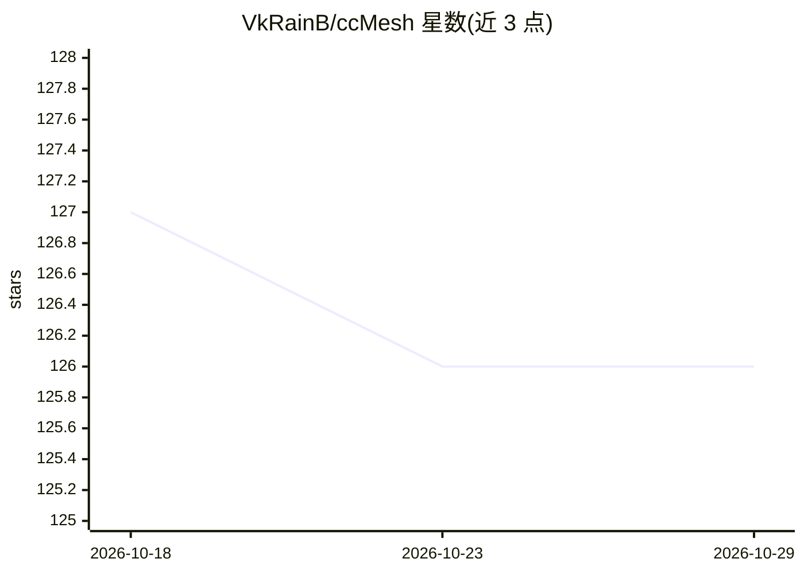

# VkRainB/ccMesh

⭐ 126 · Rust · Apache-2.0 · 推送 2026-10-27 · [GitHub](https://github.com/VkRainB/ccMesh) · [官网](https://vkrainb.github.io/ccMesh/) · 个人维护 · 中文 README

**桌面端 AI 代理网关：统一接入 Claude/OpenAI/Codex 上游**

基于 Tauri 2 + Rust + React 19 的跨平台桌面 AI 代理网关，面向使用 Claude Code / Codex CLI 的开发者。在本机启动本地代理服务，统一接入 claude（直通）、openai（转换）、codex（Responses）三类上游端点，提供 Anthropic Messages 与 OpenAI 兼容协议转换、入站/出站模型映射、按模型过滤的端点轮换与熔断、请求统计与配置管理。以渠道方式管理 Claude Code settings.json 与 Codex auth.json/config.toml，应用前自动备份，不修改客户端本身。提供 Windows/macOS/Linux 安装包，macOS 当前为未签名版本需手动放行。

## 筛选速览

| 维度 | 判定 | 备注 |
|---|---|---|
| AI 角色 | `ai-ecosystem` | LLM/agent 周边工具 |
| 许可风险 | `permissive` | Apache-2.0 |
| 部署形态 | `desktop` | 安装包/桌面程序 |
| 模型依赖 | locked-api |  |
| 硬件要求 | — | 无带数字的原话,不猜 |
| 安装摩擦 | `low` | 无编译、无系统依赖或容器化 |
| 成熟度 | — | 结构信号不足 |

## 能力要点

- claude 直通 / openai 转换 / codex Responses 三类转换器
- 入站/出站模型映射与按模型过滤的轮换熔断
- 渠道化管理 Claude Code 与 Codex 配置文件，应用前自动备份
- 仪表盘含 Token 用量、实时请求监控（耗时/首字延迟/Token 明细）

## 适用场景

- 为 Claude Code / Codex CLI 统一配置多个上游端点与中转站
- 端点故障时自动轮换与熔断，避免单点不可用
- 跨应用统计模型用量与请求明细

## 场景标签

`模型网关` · 领域:Agent 开发

## 证据(README 行号)

> L24: ccMesh 是基于 **Tauri 2 + Rust + React 19** 的桌面端 AI 代理网关：在本机统一接入 Claude / OpenAI / Codex 等多类上游，提供协议转换、模型映射、端点轮换与熔断、请求统
> L50: - 支持 **claude（直通）**、**openai（转换）**、**codex（Responses）** 三类转换器
> L56: - 以「渠道」管理 Claude Code `settings.json` 与 Codex `auth.json` + `config.toml`

## 星数曲线

2026-10-18 127 → 2026-10-29 126（-1）

---
*卡片 v1 · prompt 1.4 · 生成 2026-10-23 · 置信度 mid · 依据 README sha `29432d3a50f8` · [字段定义](../../DATASET.md)*
