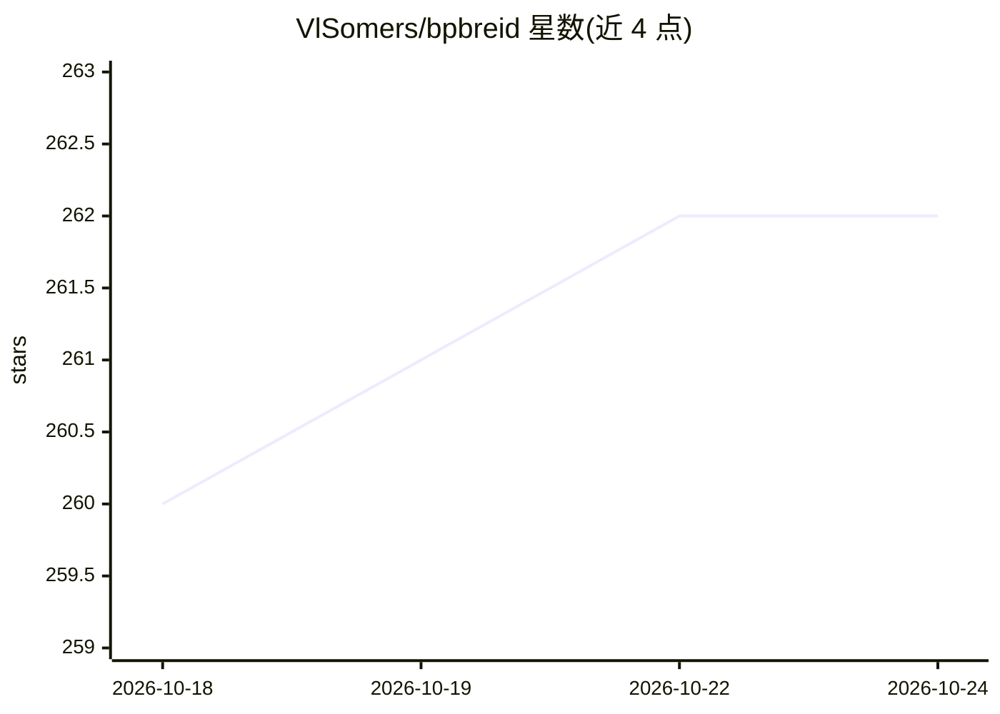

# VlSomers/bpbreid

⭐ 262 · Python · NOASSERTION · 推送 2025-11-05 · [GitHub](https://github.com/VlSomers/bpbreid) · 个人维护

**基于身体部位特征的行人重识别（含遮挡）PyTorch 基线**

WACV23 论文官方代码库，提出 BPBReID：为每个输入样本输出多个身体部位特征而非单一全局特征，训练时用伪人体解析标签学习 K 分支注意力机制并计算部位可见性分数，测试时无需解析标签；两样本相似度由互可见部位嵌入的平均距离计算。基于 Torchreid 框架扩展，提供 GiLt 损失、部位注意力损失、HRNet-W32 预训练模型、五个数据集（Market-1501 等）的解析标签下载、训练/推理配置与排序可视化工具。需 conda 环境安装并下载标签数据。

## 筛选速览

| 维度 | 判定 | 备注 |
|---|---|---|
| AI 角色 | `ai-native` | 本体是模型或模型工具 |
| 许可风险 | `none` | NOASSERTION |
| 部署形态 | `library` | 以包/库形式分发 |
| 模型依赖 | — | README 未给出锁定关系 |
| 硬件要求 | — | 无带数字的原话,不猜 |
| 安装摩擦 | `medium` | 含编译或系统依赖之一 |
| 成熟度 | — | 结构信号不足 |

## 能力要点

- 部位级特征表示：每样本输出 K 个身体部位嵌入及可见性分数
- 训练用伪人体解析标签学注意力，测试时无需解析标签
- 提供 HRNet-W32 预训练模型与五个 ReID 数据集的解析标签下载
- 基于 Torchreid 扩展：GiLt 损失、部位注意力损失、排序可视化（部位热图/局部距离）

## 适用场景

- 在五个公开数据集上训练/评测遮挡行人重识别模型
- 作为部位级 ReID 方法的基线开展进一步研究
- 用预训练模型对自己的行人图像数据做推理与可视化

## 场景标签

 · 领域:计算机视觉/行人重识别

## 证据(README 行号)

> L53: In this work, we propose BPBReID, a part-based method for person re-identification using body part feature represen
> L60: Our model BPBreID uses pseudo human parsing labels at training time to learn an attention mechanism. This attention
> L67: Our code is based on the popular Torchreid framework for person re-identification.

## 星数曲线

2026-10-18 260 → 2026-10-24 262（+2）

---
*卡片 v1 · prompt 1.4 · 生成 2026-10-22 · 置信度 mid · 依据 README sha `467982d4ba12` · [字段定义](../../DATASET.md)*
