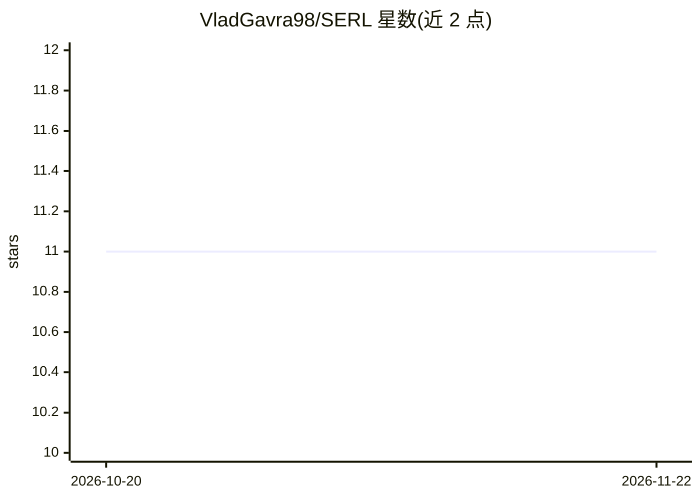

# VladGavra98/SERL

⭐ 11 · Python · MIT · 推送 2026-10-28 · [GitHub](https://github.com/VladGavra98/SERL) · 个人维护

**研究者：混合进化+强化学习的容错飞行控制器训练框架**

SERL 是用于训练与评估容错飞行控制策略的源码仓库，将 TD3 深度强化学习与遗传算法结合，在基于 DASMAT 的固定翼飞机高保真非线性模型上训练 attitude tracking 控制器。环境支持 3 种配平条件与 6 类子系统故障仿真，超参数经贝叶斯优化调优。仅在 Linux 下测试，Windows 无法加载环境的 .so 文件；安装需克隆仓库并安装 requirements.txt。附论文摘要与学位论文链接，出自 TU Delft 硕士课题。

## 筛选速览

| 维度 | 判定 | 备注 |
|---|---|---|
| AI 角色 | `ai-native` | 本体是模型或模型工具 |
| 许可风险 | `permissive` | MIT |
| 部署形态 | `library` | 以包/库形式分发 |
| 模型依赖 | — | README 未给出锁定关系 |
| 硬件要求 | — | 无带数字的原话,不猜 |
| 安装摩擦 | `low` | 无编译、无系统依赖或容器化 |
| 成熟度 | — | 结构信号不足 |

## 能力要点

- 结合 TD3 与遗传算法的混合训练框架
- 基于 DASMAT 的高保真固定翼非线性模型环境
- 支持 3 种配平条件与 6 类子系统故障仿真
- 提供预训练智能体评估与训练脚本

## 适用场景

- 训练和评估容错飞行控制策略
- 复现论文中的强化学习与进化算法对比实验
- 在仿真中测试故障与扰动下的控制器鲁棒性

## 场景标签

`强化学习` · 领域:训练与推理

## 证据(README 行号)

> L8: This repository contains the source code used to train and evalaute the **SERL** framework which combines TD3 and a 
> L15: Recent research in bio-inspired artificial intelligence potentially provides solutions to the challenging problem o

## 星数曲线

2026-10-20 11 → 2026-11-22 11（+0）

---
*卡片 v1 · prompt 1.4 · 生成 2026-11-18 · 置信度 mid · 依据 README sha `be63ec9bf71b` · [字段定义](../../DATASET.md)*
