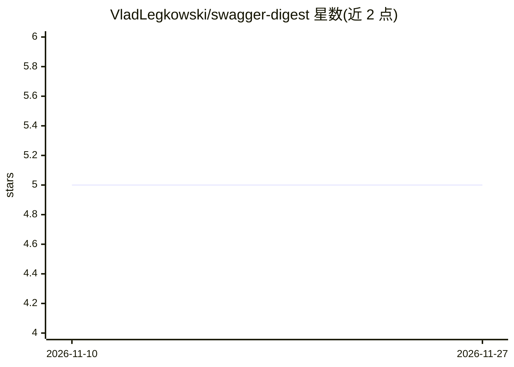

# VladLegkowski/swagger-digest

⭐ 5 · TypeScript · MIT · 推送 2026-11-09 · [GitHub](https://github.com/VladLegkowski/swagger-digest) · [官网](https://www.npmjs.com/package/swagger-digest) · 个人维护

**为 AI 编码代理把大型 OpenAPI 规范压缩为可查询的 API 上下文**

swagger-digest 是面向 AI 编码代理的 API 上下文引擎，提供两种使用方式：作为 MCP 服务器供代理按需拉取端点与 schema（含标签/路径过滤、token 预算裁剪、Swagger UI 页面自动发现规范），或以 CLI 生成结构化 Markdown 摘要（端点索引、鉴权/参数/响应细节、TypeScript 风格类型声明）。要求 Node.js 20+，经 npm/npx 分发，默认启用 SSRF 防护与 250k token 上限；README 自述基准显示超大规格（如 Kubernetes 级）可能出现压缩反转为已知失效模式。

## 筛选速览

| 维度 | 判定 | 备注 |
|---|---|---|
| AI 角色 | `ai-ecosystem` | LLM/agent 周边工具 |
| 许可风险 | `permissive` | MIT |
| 部署形态 | `library` | 以包/库形式分发 |
| 模型依赖 | — | README 未给出锁定关系 |
| 硬件要求 | — | 无带数字的原话,不猜 |
| 安装摩擦 | `low` | 无编译、无系统依赖或容器化 |
| 成熟度 | — | 结构信号不足 |

## 能力要点

- 将大型 Swagger/OpenAPI 规范转为 token 预算化的 Markdown 摘要（支持 OpenAPI 2.0/3.0/3.1）
- MCP 服务器提供 swagger_digest 与 api_call 工具，代理按需拉取上下文
- 多策略规范发现：直接 URL→页面脚本解析→常见路径→可选 Playwright 回退
- 标签/路径前缀过滤与确定性 max_tokens 裁剪，默认 250k token 上限

## 适用场景

- 让编码代理直接读取大型 API 规范而不撑爆上下文窗口
- 生成紧凑的 API Markdown 参考文档用于分享或贴入 PR
- 代理开发前端页面时按 tag 过滤获取相关端点契约

## 场景标签

 · 领域:开发者工具/LLM 上下文工程

## 证据(README 行号)

> L10: **An API context engine for AI coding agents.** Turn large Swagger/OpenAPI specifications into compact, structured,
> L21: swagger-digest solves this at two levels: a **digest** (compact, complete, token-budgeted Markdown) and an **MCP se
> L72: Requires Node.js 20+. Run `npx swagger-digest --help` for all options.

## 星数曲线

2026-11-10 5 → 2026-11-27 5（+0）

---
*卡片 v1 · prompt 1.4 · 生成 2026-11-21 · 置信度 high · 依据 README sha `b8341ecbbaab` · [字段定义](../../DATASET.md)*
