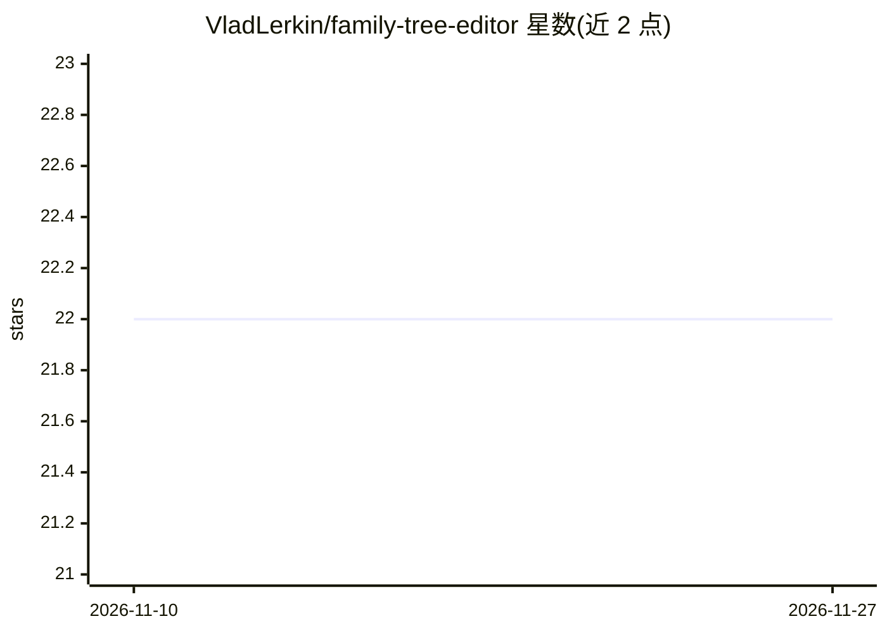

# VladLerkin/family-tree-editor

⭐ 22 · Kotlin · 推送 2026-11-10 · [GitHub](https://github.com/VladLerkin/family-tree-editor) · 个人维护

**跨平台家谱编辑器，含交互式树可视化与 AI 族谱研究代理**

基于 Kotlin Multiplatform 与 Compose Multiplatform 的家谱编辑器，提供交互式树可视化（平移/缩放）、JSON 持久化、Markdown 导出与检查面板查看编辑个人/家庭信息。AI 部分为族谱研究代理，可自主研究并扩展家谱。支持多平台分发：macOS（Apple Silicon）、Linux（deb/AppImage）、Windows（MSI/便携 exe）、Android 与 Android TV（APK）、iOS（开发者构建），桌面与移动端均可下载即用，无需自行编译；也可通过 Gradle 从源码构建运行。

## 筛选速览

| 维度 | 判定 | 备注 |
|---|---|---|
| AI 角色 | `ai-enhanced` | 去掉 AI 部分产品仍成立 |
| 许可风险 | `none` | — |
| 部署形态 | `desktop` | 安装包/桌面程序 |
| 模型依赖 | — | README 未给出锁定关系 |
| 硬件要求 | — | 无带数字的原话,不猜 |
| 安装摩擦 | `medium` | 含编译或系统依赖之一 |
| 成熟度 | — | 结构信号不足 |

## 能力要点

- 交互式家谱可视化（平移/缩放/导航）
- JSON 持久化与 Markdown 导出
- AI 族谱代理：自主研究并扩展家谱
- 六平台分发（macOS/Linux/Windows/Android/Android TV/iOS），下载即用

## 适用场景

- 记录和可视化编辑家族世系
- 以 JSON 格式保存家谱并导出 Markdown 文档
- 让 AI 代理自主研究补充家族信息

## 场景标签

`知识库管理` · 领域:知识与检索

## 证据(README 行号)

> L11: - 📊 **Interactive Tree Visualization** - Pan, zoom, and navigate your family tree
> L16: - 🤖 **AI Genealogy Agent** - Autonomous research and expansion using professional protocols (Documentation)

## 星数曲线

2026-11-10 22 → 2026-11-27 22（+0）

---
*卡片 v1 · prompt 1.4 · 生成 2026-11-18 · 置信度 mid · 依据 README sha `ee8ba921774a` · [字段定义](../../DATASET.md)*
