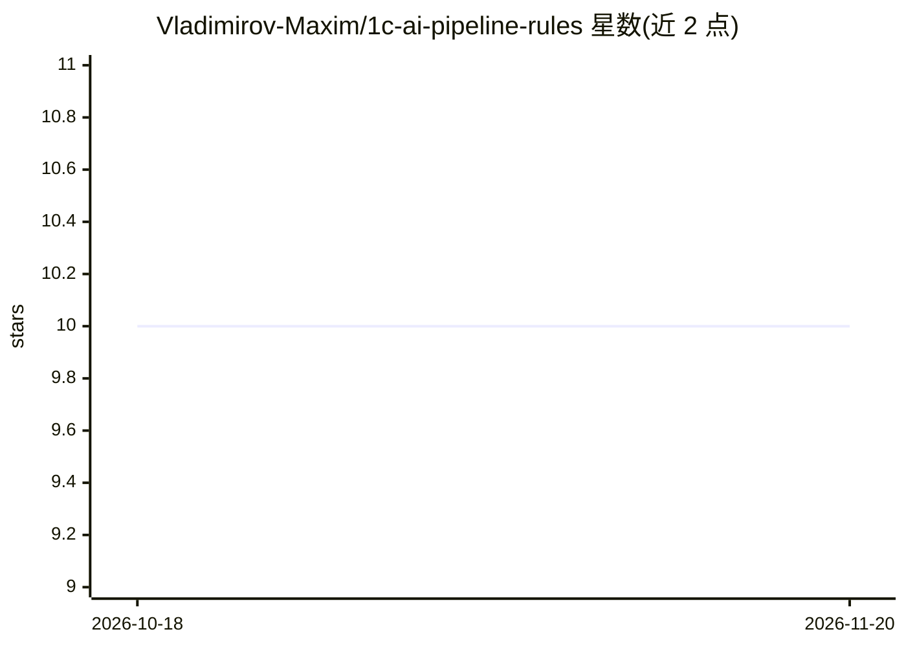

# Vladimirov-Maxim/1c-ai-pipeline-rules

⭐ 10 · Markdown · CC-BY-4.0 · 推送 2026-08-24 · [GitHub](https://github.com/Vladimirov-Maxim/1c-ai-pipeline-rules) · [官网](https://infostart.ru/1c/articles/2767171/) · 个人维护

**1C 二次开发的多智能体提示词与流程规范集**

面向 1С:БП КОРП 配置二次开发的七个 AI 代理提示词集合，配套开发规范与编排者流程文档，来自作者公开文章后的实际工作流程。包含 CLAUDE.md 管道定义、角色划分（分析师/架构师无源码写入权、审查者只读 git）、代码规范与检查清单。规则针对作者自身配置与缺陷持续演进，README 明确说明需按自身项目定制，且引用的 MCP 工具（RAG 索引、BSL Language Server 等）不在仓库内。文档 CC BY 4.0，一个脚本 MIT。

## 筛选速览

| 维度 | 判定 | 备注 |
|---|---|---|
| AI 角色 | `ai-knowledge` | 知识聚合/清单类 |
| 许可风险 | `viral` | CC-BY-4.0 |
| 部署形态 | `None` |  |
| 模型依赖 | — | README 未给出锁定关系 |
| 硬件要求 | — | 无带数字的原话,不猜 |
| 安装摩擦 | `low` | 无编译、无系统依赖或容器化 |
| 成熟度 | — | 结构信号不足 |

## 能力要点

- 七个角色的代理提示词与编排者流程文档
- 角色权限隔离：分析师/架构师无写入权，审查者 git 只读
- 明确的定制指南（前缀、插入标记、任务号、路径）
- 文档 CC BY 4.0、脚本 MIT 双许可声明

## 适用场景

- 为 1C 配置二次开发搭建多代理审查流程
- 参考其角色权限划分设计自己的代理管道
- 借鉴基于真实任务缺陷沉淀代码规范的方法

## 场景标签

`多智能体` `提示工程` `代码审查` · 领域:Agent 开发

## 证据(README 行号)

> L1: # Конвейер ИИ-агентов для доработки 1С: промпты и регламент
> L3: Промпты семи агентов, регламент разработки и процесс оркестратора — по ним у нас
> L14: CLAUDE.md                     устройство пайплайна, роли, границы записи, контекст

## 星数曲线

2026-10-18 10 → 2026-11-20 10（+0）

---
*卡片 v1 · prompt 1.4 · 生成 2026-11-20 · 置信度 high · 依据 README sha `15b4cd9aa69b` · [字段定义](../../DATASET.md)*
