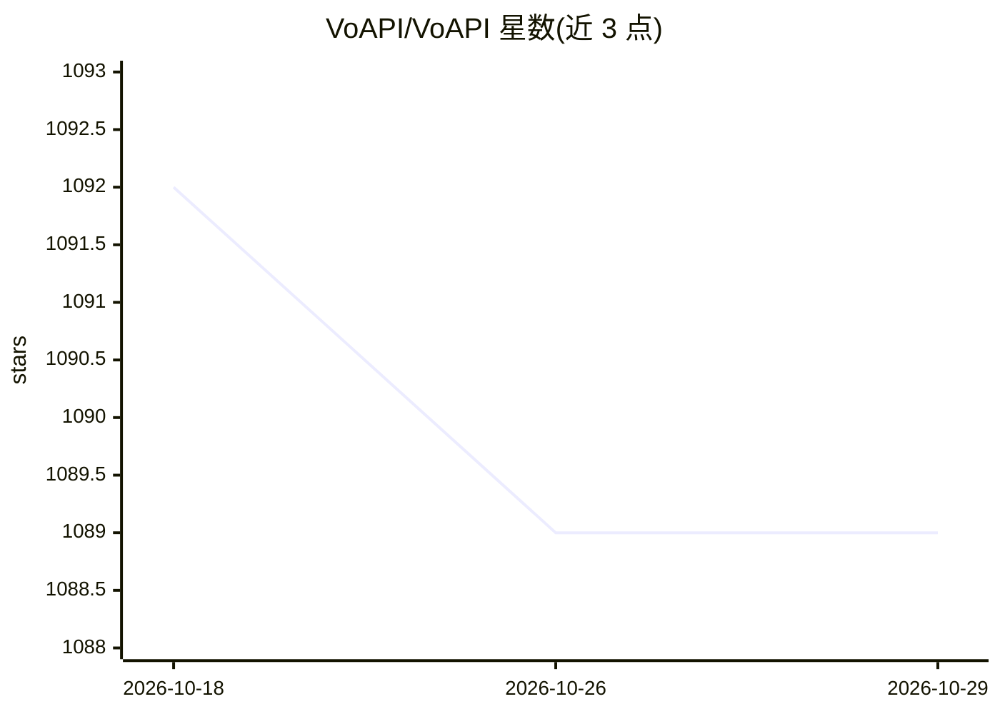

# VoAPI/VoAPI

⭐ 1,089 · Go · NOASSERTION · 推送 2026-01-27 · [GitHub](https://github.com/VoAPI/VoAPI) · [官网](https://demo.voapi.top) · 组织维护 · 中文 README

**AI 大模型 API 聚合分发网关系统，含社区版与 Pro 版**

VoAPI 是面向多用户的 AI 大模型 API 聚合与分发系统：提供 API 数据转发核心模块、渠道管理与分组、渠道重试/熔断/密钥错误禁用恢复、RPM/TPM 限流、多余额与多货币、阶梯计费、规则引擎（ES5/ES6 JS 语法）、兑换码、日志分表与 i18n 等功能，分为社区版与 Pro 版（Pro 增加在线支付、实名认证、工单系统、MCP 服务分发、动态路由等）。通过 Docker Compose 或单容器部署，需 MySQL 与 Redis，默认监听 6800 端口，首个注册用户即管理员。

## 筛选速览

| 维度 | 判定 | 备注 |
|---|---|---|
| AI 角色 | `ai-ecosystem` | LLM/agent 周边工具 |
| 许可风险 | `none` | NOASSERTION |
| 部署形态 | `self-host` | docker 或自建部署 |
| 模型依赖 | — | README 未给出锁定关系 |
| 硬件要求 | — | 无带数字的原话,不猜 |
| 安装摩擦 | `low` | 无编译、无系统依赖或容器化 |
| 成熟度 | `idea` | |

## 能力要点

- 渠道分组、重试、熔断、密钥错误禁用与自动恢复机制
- 规则引擎支持 ES5/ES6 JS 语法自定义转发规则
- 用户/渠道/单密钥三级实时 RPM/TPM 限流
- 社区版与 Pro 版双轨功能表，Pro 支持在线支付、MCP 分发、动态路由

## 适用场景

- 搭建面向多用户的大模型 API 转售或分发平台
- 统一管理多个上游模型渠道并做负载均衡与计费
- 团队内部对 AI API 用量做额度与权限管控

## 场景标签

`模型网关` · 领域:Agent 开发

## 证据(README 行号)

> L6:  🎉 全新下一代高颜值、高性能、高扩展的智能AI大模型API聚合分发系统
> L16: |API数据转发核心模块|✅|✅|

## 星数曲线

2026-10-18 1,092 → 2026-10-29 1,089（-3）

---
*卡片 v1 · prompt 1.4 · 生成 2026-10-21 · 置信度 high · 依据 README sha `9b88c9f79fe7` · [字段定义](../../DATASET.md)*
