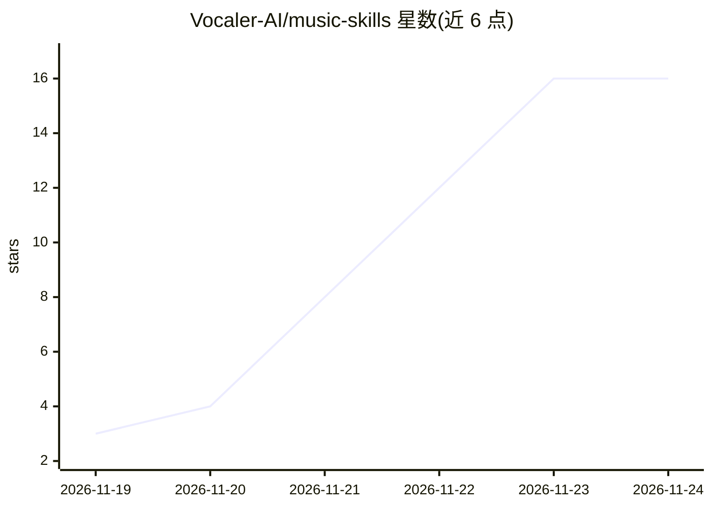

# Vocaler-AI/music-skills

⭐ 19 · Python · MIT · 推送 2026-11-18 · [GitHub](https://github.com/Vocaler-AI/music-skills) · [官网](https://skills.vocaler.ai) · 组织维护

**为音乐创作者提供可在各 agent 中运行的音乐 AI 技能集**

由 Vocaler 维护的开源 AI 技能集合，每个技能是一个含 SKILL.md 的文件夹，采用开放的 Agent Skills 格式，可在 Claude Code、Codex、Gemini CLI、Copilot、Cursor 及任何读取技能的 agent 中运行。技能按作词、AI 音乐生成提示、创作者配乐、音乐制作、音乐知识、发行发布六个类别组织，共 30 余个技能，另有 18 个计划中的技能。部分 model-aware 技能附带针对 Suno v6、Udio、Lyria、ACE-Step、Mureka 等模型格式的适配参考。通过 npx skills add 安装，MIT 许可。

## 筛选速览

| 维度 | 判定 | 备注 |
|---|---|---|
| AI 角色 | `ai-knowledge` | 知识聚合/清单类 |
| 许可风险 | `permissive` | MIT |
| 部署形态 | `library` | 以包/库形式分发 |
| 模型依赖 | — | README 未给出锁定关系 |
| 硬件要求 | — | 无带数字的原话,不猜 |
| 安装摩擦 | `low` | 无编译、无系统依赖或容器化 |
| 成熟度 | — | 结构信号不足 |

## 能力要点

- 30 余个 SKILL.md 格式技能，覆盖作词到发行六个阶段
- model-aware 技能针对 Suno/Udio/Lyria/ACE-Step/Mureka 等模型输出对应格式
- 兼容 Claude Code、Codex、Gemini CLI、Copilot、Cursor 及任意读取技能的 agent
- npx skills add 一条命令安装全部或单个技能

## 适用场景

- 用 agent 辅助写词、编曲结构和旋律
- 为 Suno 等 AI 音乐模型生成符合其格式的提示词与歌词
- 为视频/播客/游戏规划背景音乐与配乐
- 准备发行元数据、封面图提示与发行清单

## 场景标签

`提示工程` `AI 助手` · 领域:Agent 开发

## 证据(README 行号)

> L3: Open-source AI skills for music, made by Vocaler. Each skill is a folder with a `SKILL.md` in the open
> L25: ## Skills
> L42: ### AI music generation

## 星数曲线

2026-11-19 3 → 2026-11-24 16（+13）

---
*卡片 v1 · prompt 1.4 · 生成 2026-11-21 · 置信度 high · 依据 README sha `10d5079cef54` · [字段定义](../../DATASET.md)*
