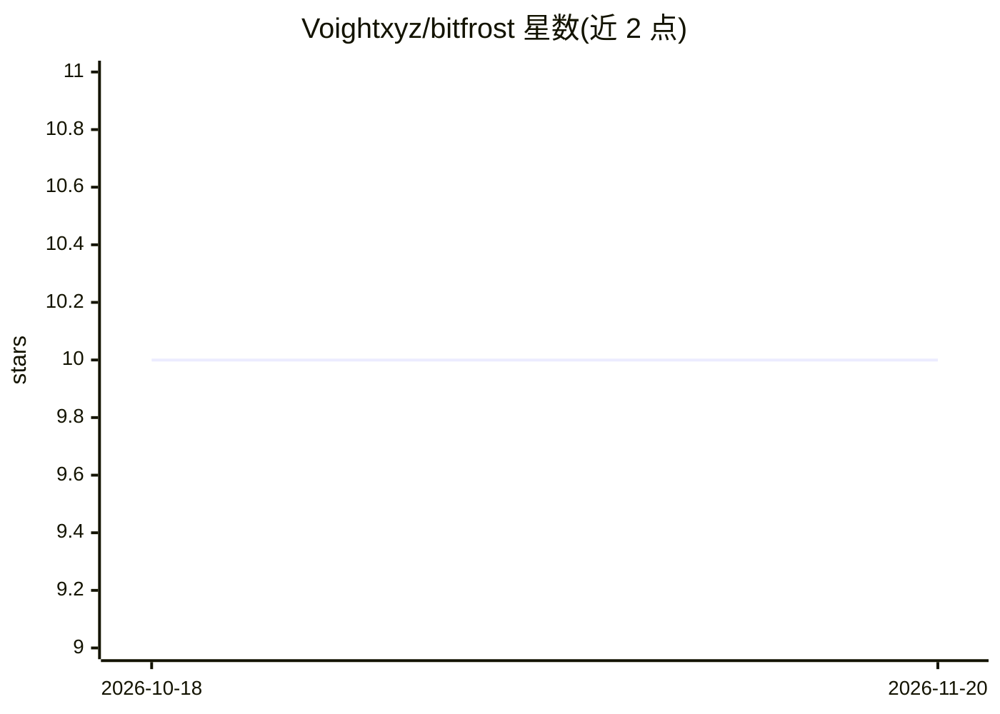

# Voightxyz/bitfrost

⭐ 10 · Python · MIT · 推送 2026-09-26 · [GitHub](https://github.com/Voightxyz/bitfrost) · [官网](https://docs.voight.xyz/python/bitfrost) · 组织维护

**Python LLM 应用的本地 OpenTelemetry 可观测性工具**

bitfrost 把 Python LLM 库已产生的 OpenTelemetry span 转换为可查询的事件流，输出到终端、本地 Web 仪表盘、SQLite、JSONL 或任意 OTLP 后端。提供五个后端、四个自动插桩助手（openai/anthropic/litellm/smolagents）、CLI、TUI 与离线仪表盘；默认不联网、无需账号，内置三级隐私控制与 PII 清洗，故障路径降级不中断应用。核心为纯本地运行，Voight 托管服务为可选后端。

## 筛选速览

| 维度 | 判定 | 备注 |
|---|---|---|
| AI 角色 | `ai-ecosystem` | LLM/agent 周边工具 |
| 许可风险 | `permissive` | MIT |
| 部署形态 | `library` | 以包/库形式分发 |
| 模型依赖 | — | README 未给出锁定关系 |
| 硬件要求 | — | 无带数字的原话,不猜 |
| 安装摩擦 | `low` | 无编译、无系统依赖或容器化 |
| 成熟度 | — | 结构信号不足 |

## 能力要点

- 一行 quickstart 自动检测 openai/anthropic/litellm/smolagents
- 五种后端（Console/SQLite/JSONL/OTLP/Voight/Tee 扇出）
- 三级隐私控制，含 12 种 PII 模式与 Luhn 校验的事前清洗
- CLI 支持 watch/replay/query/vacuum 及本地 TUI 与 Web 仪表盘

## 适用场景

- 本地查看 Python LLM 应用的调用流、token 与成本
- 将 OpenTelemetry 事件导出到自有 collector 或 webhook
- 用 SQLite 持久化并离线回放、SQL 查询历史运行
- 发送前清洗提示词中的敏感信息

## 场景标签

`LLM 可观测性` · 领域:评测与运维

## 证据(README 行号)

> L13: Bitfrost turns the OpenTelemetry spans your LLM libraries already emit into a clean, queryable event stream — in yo
> L28: - **Standalone first.** Capture to your terminal, a JSONL file, or SQLite with zero configuration and zero network 

## 星数曲线

2026-10-18 10 → 2026-11-20 10（+0）

---
*卡片 v1 · prompt 1.4 · 生成 2026-11-20 · 置信度 high · 依据 README sha `aaf087afcbc2` · [字段定义](../../DATASET.md)*
