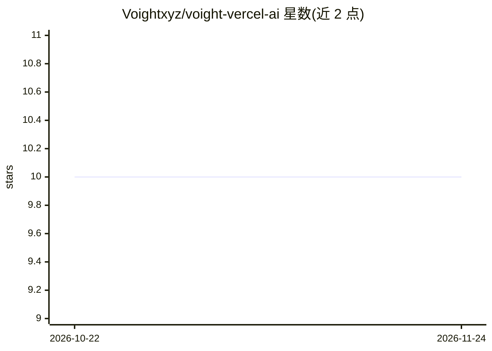

# Voightxyz/voight-vercel-ai

⭐ 10 · TypeScript · Apache-2.0 · 推送 2026-10-03 · [GitHub](https://github.com/Voightxyz/voight-vercel-ai) · [官网](https://docs.voight.xyz/ai-apps/vercel-ai) · 组织维护

**Vercel AI SDK 的 OpenTelemetry 上报导出器，接入 Voight 可观测面板**

面向使用 Vercel AI SDK 的 JavaScript 开发者的 npm 包：注册一个 OpenTelemetry SpanExporter，读取 SDK 在 experimental_telemetry 开启时产生的 span，提取模型 ID、提示消息、token 计数、缓存读取、工具调用、延迟与错误等字段，发送至 Voight 后端并在仪表板展示。提供三档隐私级别（含 PII 清洗）、与同系列 openai/anthropic 包的去重机制，以及通过 MultiSpanProcessor 与 Langfuse、Datadog 等其他 OTel 工具并行运行的方式。Apache 2.0 许可。

## 筛选速览

| 维度 | 判定 | 备注 |
|---|---|---|
| AI 角色 | `ai-ecosystem` | LLM/agent 周边工具 |
| 许可风险 | `permissive` | Apache-2.0 |
| 部署形态 | `library` | 以包/库形式分发 |
| 模型依赖 | — | README 未给出锁定关系 |
| 硬件要求 | — | 无带数字的原话,不猜 |
| 安装摩擦 | `low` | 无编译、无系统依赖或容器化 |
| 成熟度 | `idea` | |

## 能力要点

- OpenTelemetry SpanExporter 形式接入，读取 experimental_telemetry span
- 捕获 token 计数、缓存读写、工具调用、延迟与错误等字段
- 三档隐私级别，standard 档含 12 种 PII 模式清洗
- 与同系列 wrapper 包的去重机制及 MultiSpanProcessor 并行导出

## 适用场景

- 为 Next.js 中基于 Vercel AI SDK 的 LLM 调用接入遥测监控
- 在与其他 OTel 可观测工具并存时收集 AI 调用数据
- 生产环境按隐私级别清洗提示词与响应内容后上报

## 场景标签

`LLM 可观测性` · 领域:评测与运维

## 证据(README 行号)

> L5: Voight observability for the Vercel AI SDK. An OpenTelemetry `SpanExporter` that ingests the `experimental_telemetry
> L11: The Vercel AI SDK emits OpenTelemetry spans natively when you flip `experimental_telemetry: { isEnabled: true }` on

## 星数曲线

2026-10-22 10 → 2026-11-24 10（+0）

---
*卡片 v1 · prompt 1.4 · 生成 2026-11-20 · 置信度 high · 依据 README sha `9c7cafc052d0` · [字段定义](../../DATASET.md)*
