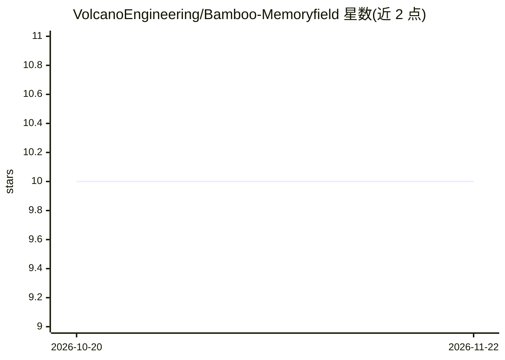

# VolcanoEngineering/Bamboo-Memoryfield

⭐ 10 · Python · NOASSERTION · 推送 2026-07-01 · [GitHub](https://github.com/VolcanoEngineering/Bamboo-Memoryfield) · [官网](https://memoryfield.ai) · 个人维护

**AI 辅助仓库的多智能体治理与记忆脚手架**

将普通仓库转化为受治理的工作空间：以 AGENT.md 路由、Bamboo.md 策略层、behavior 规则集和叙事历史文档为核心纪律，要求仅维护三个核心概念（Knobs 状态变更日志、PLTRF 结构完整性、Hot/Warm/Cold/Ice 记忆分层）；核心纪律不依赖任何供应商与外部依赖，可直接复制到项目根目录使用，Bamboo OS 运行时引擎（生命周期管理、心跳、多智能体拓扑）则通过私有仓库提供。适用于在 AI 辅助开发中管理多智能体协作的项目维护者。

## 筛选速览

| 维度 | 判定 | 备注 |
|---|---|---|
| AI 角色 | `ai-ecosystem` | LLM/agent 周边工具 |
| 许可风险 | `none` | NOASSERTION |
| 部署形态 | `None` |  |
| 模型依赖 | — | README 未给出锁定关系 |
| 硬件要求 | — | 无带数字的原话,不猜 |
| 安装摩擦 | `low` | 无编译、无系统依赖或容器化 |
| 成熟度 | — | 结构信号不足 |

## 能力要点

- 三概念核心纪律：Knobs、PLTRF、Tiering 记忆分层
- 核心纪律供应商中立且无依赖，复制文件即用
- CI 门禁在智能体违反规则时使构建失败（里程碑记录）
- Bamboo OS 运行时引擎经私有仓库管理访问

## 适用场景

- 为多智能体协作仓库建立策略与记忆规范
- 防止 AI 会话导致的项目漂移与记忆退化
- 用 Hot/Warm/Cold/Ice 分层管理长期项目文档

## 场景标签

`多智能体` `Agent 记忆` · 领域:Agent 开发

## 证据(README 行号)

> L16: Bamboo transforms a standard repository into a **Governed Workspace**. It provides the stable policy, memory, and r
> L30: **The core discipline is vendor-neutral and dependency-free.**
> L33: For multi-agent or complex environments, the **Bamboo OS** runtime extension provides the high-fidelity chassis for

## 星数曲线

2026-10-20 10 → 2026-11-22 10（+0）

---
*卡片 v1 · prompt 1.4 · 生成 2026-11-20 · 置信度 mid · 依据 README sha `e6568a92d26a` · [字段定义](../../DATASET.md)*
