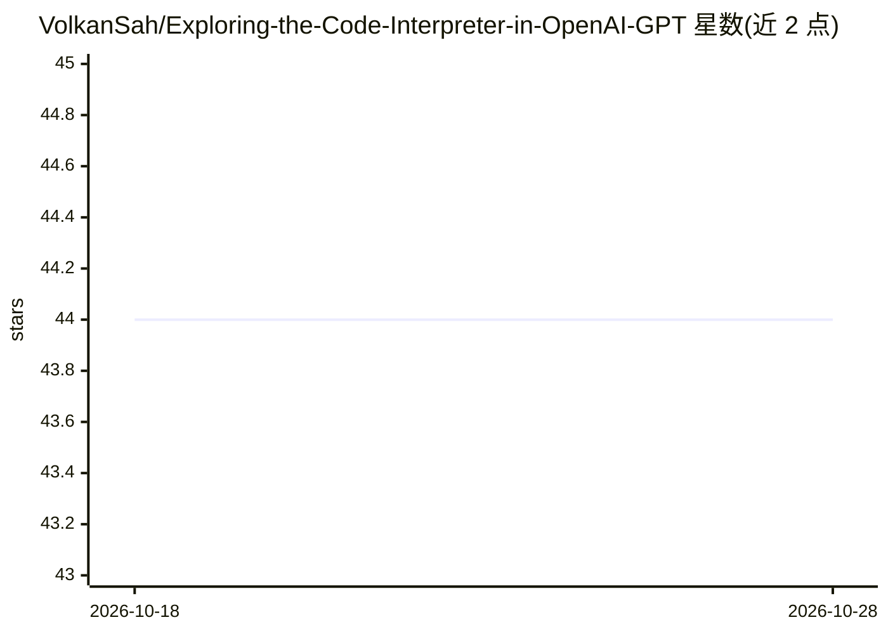

# VolkanSah/Exploring-the-Code-Interpreter-in-OpenAI-GPT

⭐ 44 · MIT · 推送 2025-12-11 · [GitHub](https://github.com/VolkanSah/Exploring-the-Code-Interpreter-in-OpenAI-GPT) · [官网](https://volkansah.github.io/The-Code-Interpreter-in-OpenAI-GPT/) · 个人维护

**OpenAI GPT 代码执行环境的介绍与示例教程仓库**

介绍 ChatGPT 内置代码执行环境（原 Code Interpreter）的教程型仓库：说明其用途（数学计算、数据分析、原型调试、文件处理）、沙箱限制（无网络、约 300 秒运行时限、仅 /mnt/data 可读写、会话后重置），并提供图像、Excel、Word、PDF 读写与处理的 Python 示例代码。内容为文档与示例，非可运行软件产品；本地复现示例需自行安装 pandas、pypdf 等依赖库。

## 筛选速览

| 维度 | 判定 | 备注 |
|---|---|---|
| AI 角色 | `ai-knowledge` | 知识聚合/清单类 |
| 许可风险 | `permissive` | MIT |
| 部署形态 | `library` | 以包/库形式分发 |
| 模型依赖 | — | README 未给出锁定关系 |
| 硬件要求 | — | 无带数字的原话,不猜 |
| 安装摩擦 | `low` | 无编译、无系统依赖或容器化 |
| 成熟度 | — | 结构信号不足 |

## 能力要点

- 说明沙箱限制：无网络、无宿主系统访问、约 300 秒运行时限、仅 /mnt/data 可读写
- 覆盖图像（PIL/matplotlib）、Excel（pandas）、Word（python-docx）、PDF（pypdf/fpdf）处理示例
- 提供本地复现示例的依赖库安装命令

## 适用场景

- 了解 ChatGPT 代码执行环境能做什么、限制是什么
- 学习在沙箱内处理 Excel/Word/PDF/图像文件的写法
- 入门数据分析与 Python 原型验证工作流

## 场景标签

`教程课程` · 领域:学习与行业

## 证据(README 行号)

> L5: The code execution environment in OpenAI GPT models provides an interactive Python sandbox.
> L13: The code execution environment (formerly known as the “Code Interpreter”) is a secure Python sandbox embedded insid

## 星数曲线

2026-10-18 44 → 2026-10-28 44（+0）

---
*卡片 v1 · prompt 1.4 · 生成 2026-10-25 · 置信度 mid · 依据 README sha `2b7ca0b2ca7c` · [字段定义](../../DATASET.md)*
