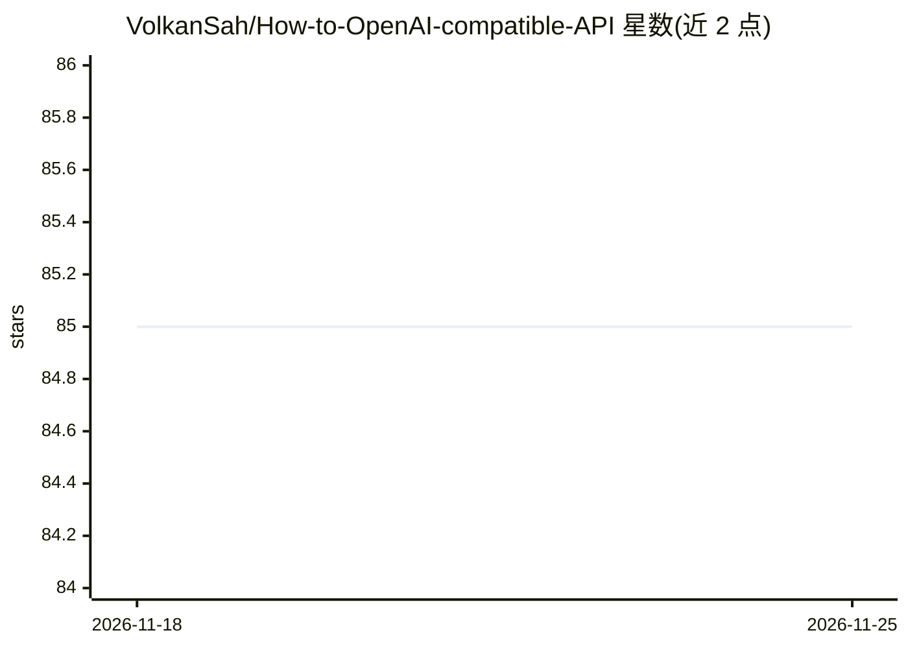

# VolkanSah/How-to-OpenAI-compatible-API

⭐ 85 · PHP · MIT · 推送 2026-11-17 · [GitHub](https://github.com/VolkanSah/How-to-OpenAI-compatible-API) · [官网](https://github.com/VolkanSah/How-to-OpenAI-compatible-API/) · 个人维护

**面向任何 OpenAI 兼容 API 的无依赖 PHP 聊天挂件**

GPTChat 是一个极简的聊天组件（PHP + 原生 JS，无 Composer/npm/构建步骤），可对接任何 OpenAI 兼容 API：OpenAI、OpenRouter、Ollama、LM Studio、llama.cpp、vLLM 等。后端校验输入、可选调用 /moderations 审核并注入服务端系统提示，通过 SSE 流式转发到浏览器；API key 保留在服务端。提供按 IP 限流、消息长度/条数上限、同源 CORS 等安全措施。要求 PHP 7.4+（curl、mbstring 扩展），通过 git clone 源码部署。注意事项：端点本身无用户认证，公开暴露会消耗 API 配额。

## 筛选速览

| 维度 | 判定 | 备注 |
|---|---|---|
| AI 角色 | `ai-ecosystem` | LLM/agent 周边工具 |
| 许可风险 | `permissive` | MIT |
| 部署形态 | `None` |  |
| 模型依赖 | local-ok | 支持本地模型 |
| 硬件要求 | — | 无带数字的原话,不猜 |
| 安装摩擦 | `low` | 无编译、无系统依赖或容器化 |
| 成熟度 | — | 结构信号不足 |

## 能力要点

- 对接任意 OpenAI 兼容 API，仅需改 base URL、key 与模型名
- SSE 流式响应与停止按钮，携带对话历史
- API key 保留服务端，系统提示不可被客户端覆盖
- 按 IP 限流、输入限制、可选 /moderations 审核

## 适用场景

- 在自己的网站上快速嵌入可自选模型的聊天挂件
- 配合本地 Ollama / llama.cpp / vLLM 搭建自托管聊天界面
- 需要服务端持有 key、可控系统提示的轻量部署

## 场景标签

`聊天机器人` · 领域:对话与助手

## 证据(README 行号)

> L3: A minimal, dependency-free chat widget (PHP + vanilla JS) that works with **any OpenAI-compatible API**: OpenAI, Ope
> L64: browser ──POST {messages}──▶ gptchat.php ──POST /chat/completions (stream)──▶ provider

## 星数曲线

2026-11-18 85 → 2026-11-25 85（+0）

---
*卡片 v1 · prompt 1.4 · 生成 2026-11-18 · 置信度 high · 依据 README sha `85fac72ca9fe` · [字段定义](../../DATASET.md)*
