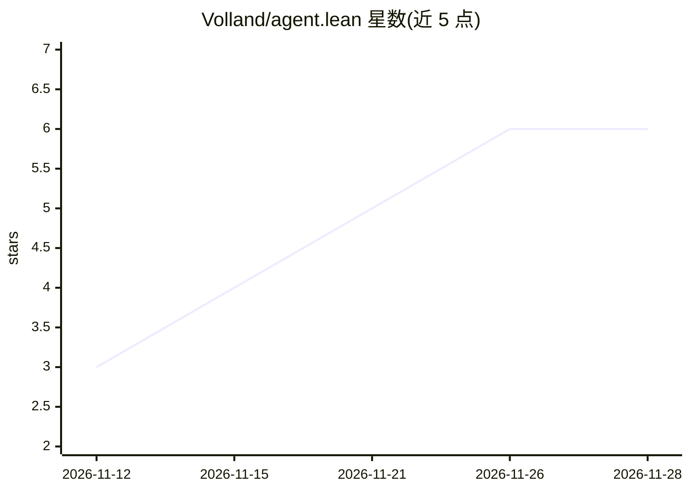

# Volland/agent.lean

⭐ 6 · Lean · Apache-2.0 · 推送 2026-11-06 · [GitHub](https://github.com/Volland/agent.lean) · 个人维护

**给嵌入式/移动端开发者的可验证 Lean 4 LLM agent 库**

Lean 4 编写的 agent 库，核心是确定性 step 函数（状态+事件→新状态+效果），支持 OpenAI 兼容与 Anthropic 编解码、工具调用与时间逻辑策略监控，策略以定理形式在构造上强制执行。Lean 编译为 C，通过 C ABI 及 Swift/Kotlin 绑定部署到 iOS、Android 与嵌入式 Linux（静态 musl）。事件溯源 trace 支持精确恢复与回归测试。v0.1 preview，API 可能变化。

## 筛选速览

| 维度 | 判定 | 备注 |
|---|---|---|
| AI 角色 | `ai-ecosystem` | LLM/agent 周边工具 |
| 许可风险 | `permissive` | Apache-2.0 |
| 部署形态 | `None` |  |
| 模型依赖 | local-ok | 支持本地模型 |
| 硬件要求 | — | 无带数字的原话,不猜 |
| 安装摩擦 | `low` | 无编译、无系统依赖或容器化 |
| 成熟度 | `idea` | |

## 能力要点

- 策略规则编译为带可靠性定理的监控器，效果发生前拒绝违规
- Lean 编译为 C，静态 musl 产物约 1.3–1.7 MB，无解释器与 GC VM
- 进程内 llama.cpp 适配器支持本地模型语法约束工具调用
- Swift 与 Kotlin 手写绑定，经同一 golden trace 一致性测试

## 适用场景

- 在树莓派或工业网关上运行带工具调用的 LLM agent
- 需要形式化保证的策略约束（如每轮最多 3 次抓取）
- 手机 app 内嵌 agent，OS 杀进程后从 trace 精确恢复
- 防提示注入触发受保护动作的场景

## 场景标签

`Agent 框架` · 领域:Agent 开发

## 证据(README 行号)

> L5:  A tiny, verifiable agent library in Lean 4 that compiles to C.
> L6:  Write LLM agents with tools in Lean, prove what they may do, and ship them to phones and embedded boards.
> L19: - **Proofs about agents.** Rules such as *"`send_payment` only after `confirm_user` in the same turn"* or *"at most

## 星数曲线

2026-11-12 3 → 2026-11-28 6（+3）

---
*卡片 v1 · prompt 1.4 · 生成 2026-11-21 · 置信度 high · 依据 README sha `a0f847e1927e` · [字段定义](../../DATASET.md)*
