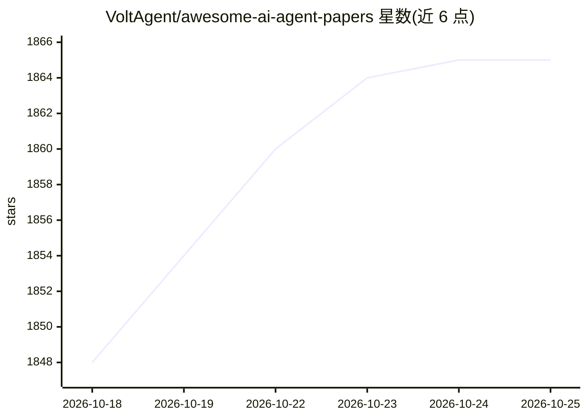

# VoltAgent/awesome-ai-agent-papers

⭐ 1,867 · MIT · 推送 2026-10-25 · [GitHub](https://github.com/VoltAgent/awesome-ai-agent-papers) · [官网](https://starterkit.getdesign.md/) · 组织维护

**2026 年 AI Agent 研究论文策展清单，按主题分类并每周更新**

由 VoltAgent 维护的 arXiv 论文精选清单，仅收录 2026 年 1 月起发表的论文，主题覆盖多智能体协作、记忆与 RAG、工具使用、评测与可观测性、安全等 AI agent 生态核心方向。维护方每周从 arXiv 筛选与 agent 生态直接相关的论文并分类，面向构建 agent 系统的工程师、研究架构的研究者及将 LLM agent 集成到产品的开发者。当前 README 展示 Multi-Agent 类别 54 篇，条目附标题与摘要说明。

## 筛选速览

| 维度 | 判定 | 备注 |
|---|---|---|
| AI 角色 | `ai-knowledge` | 知识聚合/清单类 |
| 许可风险 | `permissive` | MIT |
| 部署形态 | `None` |  |
| 模型依赖 | — | README 未给出锁定关系 |
| 硬件要求 | — | 无带数字的原话,不猜 |
| 安装摩擦 | `low` | 无编译、无系统依赖或容器化 |
| 成熟度 | — | 结构信号不足 |

## 能力要点

- 仅收录 2026 年 1 月后发表的 arXiv 论文
- 覆盖多智能体、记忆/RAG、评测、安全等主题分类
- 每周从 arXiv 更新并做相关性筛选

## 适用场景

- 跟踪 AI agent 领域最新研究进展
- 按主题查找多智能体协作、记忆与评测方向的论文
- 了解 agent 研究中正在验证的方法与发现

## 场景标签

`精选清单` · 领域:学习与行业

## 证据(README 行号)

> L14: A curated collection of research papers **published in 2026** and sourced from arXiv, covering core topics from the
> L16: Whether you're an AI engineer building agent systems, a researcher exploring new architectures, or a developer inte
> L22: Hundreds of papers are published on arXiv every week, and a growing number of them touch on AI agents. We go throug

## 星数曲线

2026-10-18 1,848 → 2026-10-25 1,865（+17）

---
*卡片 v1 · prompt 1.4 · 生成 2026-10-21 · 置信度 high · 依据 README sha `4b2e9ac21a43` · [字段定义](../../DATASET.md)*
