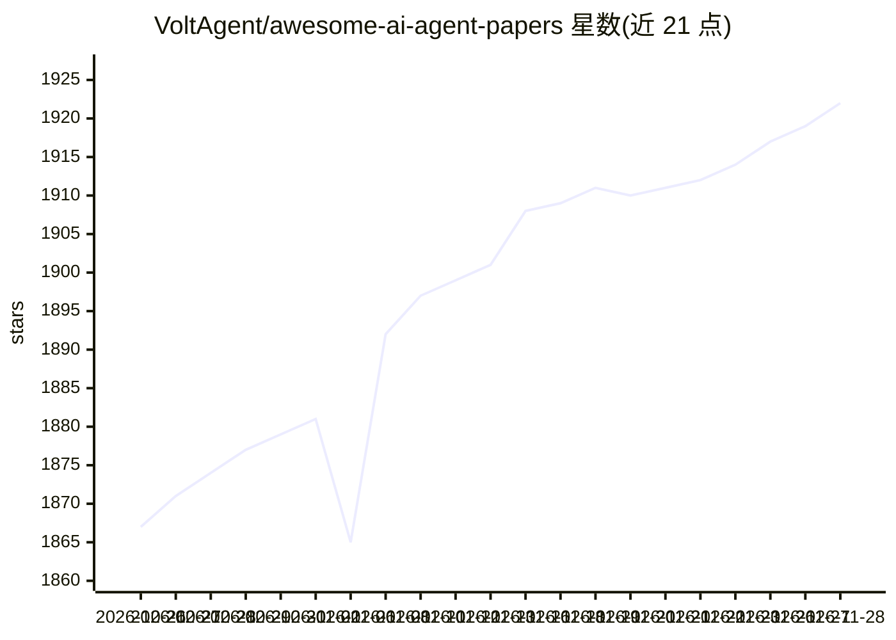

# VoltAgent/awesome-ai-agent-papers

⭐ 1,922 · MIT · 推送 2026-11-17 · [GitHub](https://github.com/VoltAgent/awesome-ai-agent-papers) · [官网](https://starterkit.getdesign.md/) · 组织维护

**面向 AI 工程师与研究者的 2026 年 agent 论文精选清单**

由 VoltAgent 维护的论文聚合清单，从 arXiv 筛选 2026 年起发表的 AI agent 相关研究并按多智能体协同、记忆与 RAG、工具、评测与可观测性、安全等主题分类，每周更新。面向构建 agent 系统的工程师、研究新架构的研究者以及将 LLM agent 集成到产品的开发者，用于跟踪领域进展；附 Discord 社区与赞助栏目。

## 筛选速览

| 维度 | 判定 | 备注 |
|---|---|---|
| AI 角色 | `ai-knowledge` | 知识聚合/清单类 |
| 许可风险 | `permissive` | MIT |
| 部署形态 | `None` |  |
| 模型依赖 | — | README 未给出锁定关系 |
| 硬件要求 | — | 无带数字的原话,不猜 |
| 安装摩擦 | `low` | 无编译、无系统依赖或容器化 |
| 成熟度 | — | 结构信号不足 |

## 能力要点

- 从 arXiv 每周筛选并分类 agent 相关论文
- 覆盖多智能体协同、记忆与 RAG、评测与可观测性、安全等主题
- 仅收录 2026 年 1 月起的论文

## 适用场景

- 为 agent 系统开发查找相关研究论文
- 跟踪 AI agent 领域的最新研究方向
- 按主题快速定位评测或安全方向的文献

## 场景标签

`精选清单` · 领域:学习与行业

## 证据(README 行号)

> L14: A curated collection of research papers **published in 2026** and sourced from arXiv, covering core topics from the
> L22: Hundreds of papers are published on arXiv every week, and a growing number of them touch on AI agents. We go throug

## 星数曲线

2026-10-26 1,867 → 2026-11-28 1,922（+55）

---
*卡片 v1 · prompt 1.4 · 生成 2026-11-23 · 置信度 high · 依据 README sha `2e07e13216d5` · [字段定义](../../DATASET.md)*
