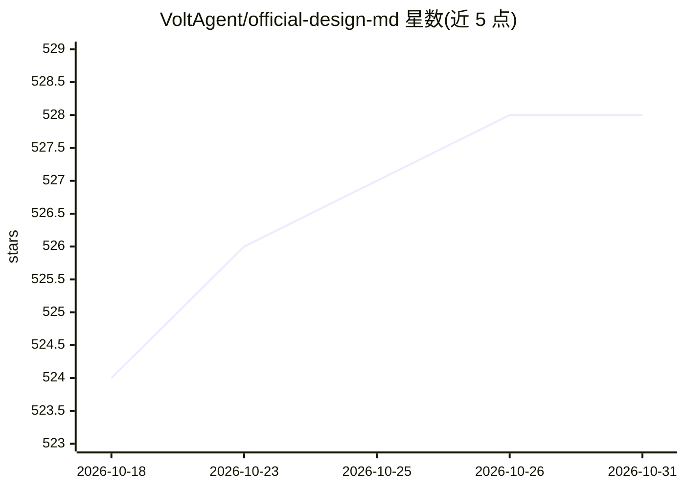

# VoltAgent/official-design-md

⭐ 528 · MIT · 推送 2026-09-21 · [GitHub](https://github.com/VoltAgent/official-design-md) · [官网](https://getdesign.md/) · 组织维护

**官方 DESIGN.md 收录清单：追踪公司自行发布的设计系统文档**

由 VoltAgent 维护的清单仓库，追踪各公司或项目自行发布的第一方 DESIGN.md 文件（明确声明非提取、非逆向、非社区制作）。DESIGN.md 是 Google Stitch 提出的纯文本设计系统文档概念，供 AI 编码/设计代理读取以生成风格一致的 UI。收录条目包括 Ant Design、Atlassian、Microsoft FAST、Vercel 等，使用方式为复制到项目根目录并告知 AI 代理使用。

## 筛选速览

| 维度 | 判定 | 备注 |
|---|---|---|
| AI 角色 | `ai-knowledge` | 知识聚合/清单类 |
| 许可风险 | `permissive` | MIT |
| 部署形态 | `None` |  |
| 模型依赖 | — | README 未给出锁定关系 |
| 硬件要求 | — | 无带数字的原话,不猜 |
| 安装摩擦 | `low` | 无编译、无系统依赖或容器化 |
| 成熟度 | `idea` | |

## 能力要点

- 只收录公司/项目自行发布的第一方 DESIGN.md
- 条目覆盖 Ant Design、Atlassian、Clerk、Vercel 等 10 项
- 附使用方法：复制到项目根目录后告知 AI 代理使用

## 适用场景

- 为 AI 编码代理寻找可复用的官方设计系统文档
- 跟踪 DESIGN.md 这一新标准的官方采用情况
- 通过 issue/PR 报告新发现的第一方 DESIGN.md

## 场景标签

`精选清单` · 领域:学习与行业

## 证据(README 行号)

> L12: The tracker for first-party DESIGN.md adoption. Every entry here is a DESIGN.md published by the company or project
> L18: DESIGN.md is a new concept introduced by Google Stitch. A plain-text design system document that AI agents read to 

## 星数曲线

2026-10-18 524 → 2026-10-31 528（+4）

---
*卡片 v1 · prompt 1.4 · 生成 2026-10-22 · 置信度 high · 依据 README sha `e5b493b2024a` · [字段定义](../../DATASET.md)*
