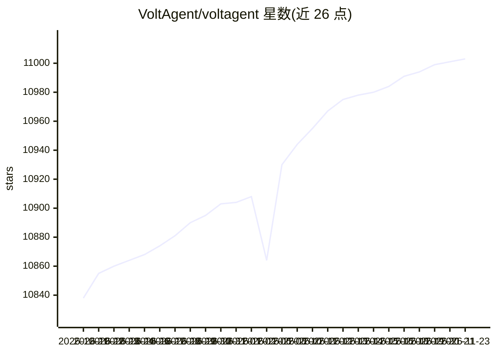

# VoltAgent/voltagent

⭐ 11,003 · TypeScript · MIT · 推送 2026-11-06 · [GitHub](https://github.com/VoltAgent/voltagent) · [官网](https://voltagent.dev) · 组织维护

**TypeScript AI Agent 框架与运维平台：构建、观测、部署 Agent**

VoltAgent 由两部分组成：开源 TypeScript Agent 框架（@voltagent/core）提供 Memory、RAG、Guardrails、工具注册、MCP 连接、Workflow 引擎、Supervisor 多 Agent 协调与可恢复流式输出；VoltOps Console（Cloud/Self-Hosted）提供可观测性、追踪、日志、Prompt 管理、评测、自动化触发与一键部署。面向开发者，通过 create-voltagent-app CLI 创建项目，npm run dev 启动本地服务器，在控制台查看与调试运行中的 Agent。

## 筛选速览

| 维度 | 判定 | 备注 |
|---|---|---|
| AI 角色 | `ai-ecosystem` | LLM/agent 周边工具 |
| 许可风险 | `permissive` | MIT |
| 部署形态 | `None` |  |
| 模型依赖 | — | README 未给出锁定关系 |
| 硬件要求 | — | 无带数字的原话,不猜 |
| 安装摩擦 | `low` | 无编译、无系统依赖或容器化 |
| 成熟度 | — | 结构信号不足 |

## 能力要点

- TypeScript 框架内置 Memory/RAG/Guardrails/Workflow/MCP 等模块
- Supervisor 与 Sub-Agent 多 Agent 协调运行时
- VoltOps 控制台提供追踪、日志、评测、Prompt 与部署
- 可恢复流式输出：客户端刷新后可重连续传

## 适用场景

- 用 TypeScript 构建带工具与记忆的生产级 Agent
- 在控制台追踪调试多步工作流与 human-in-the-loop 流程
- 接入 Airtable/Slack/WhatsApp 等渠道构建自动化 Agent

## 场景标签

`Agent 框架` `多智能体` `LLM 可观测性` `模型评测` · 领域:Agent 开发

## 证据(README 行号)

> L23: VoltAgent is an end-to-end AI Agent Engineering Platform that consists of two main parts:
> L25: - **Open-Source TypeScript Framework** – Memory, RAG, Guardrails, Tools, MCP, Voice, Workflow, and more.
> L26: - **VoltOps Console** `Cloud` `Self-Hosted` – Observability, Automation, Deployment, Evals, Guardrails, Prompts, an

## 星数曲线

2026-10-21 10,838 → 2026-11-23 11,003（+165）

---
*卡片 v1 · prompt 1.4 · 生成 2026-11-22 · 置信度 high · 依据 README sha `46b7f07cc684` · [字段定义](../../DATASET.md)*
