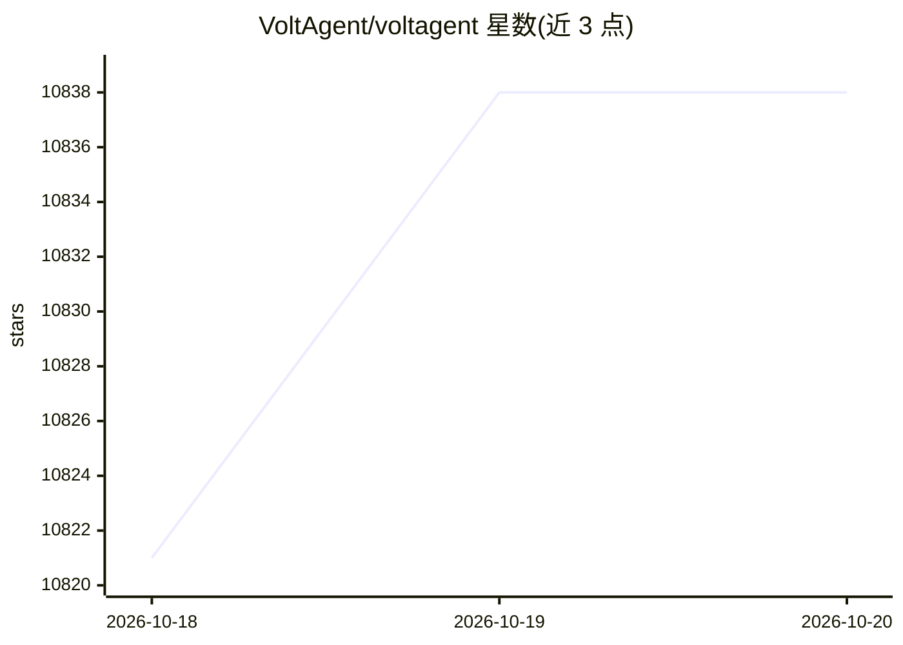

# VoltAgent/voltagent

⭐ 10,838 · TypeScript · MIT · 推送 2026-10-15 · [GitHub](https://github.com/VoltAgent/voltagent) · [官网](https://voltagent.dev) · 组织维护 · 中文 README

**TypeScript AI Agent 开发框架，含可观测性控制台平台**

由两部分组成：开源 TypeScript 框架（@voltagent/core）与 VoltOps 控制台（云端或自托管）。框架提供 Agent 定义、工作流引擎、supervisor 多智能体协调、工具注册与 MCP 接入、记忆适配器、RAG、语音、Guardrails 与评测能力，支持切换 OpenAI/Anthropic/Google 等模型提供商；VoltOps 控制台提供执行追踪、日志、Prompt 构建、部署与监控。通过 npm create voltagent-app 脚手架创建项目，附带 Airtable、Slack、WhatsApp 等示例。MIT 许可。

## 筛选速览

| 维度 | 判定 | 备注 |
|---|---|---|
| AI 角色 | `ai-ecosystem` | LLM/agent 周边工具 |
| 许可风险 | `permissive` | MIT |
| 部署形态 | `None` |  |
| 模型依赖 | — | README 未给出锁定关系 |
| 硬件要求 | — | 无带数字的原话,不猜 |
| 安装摩擦 | `low` | 无编译、无系统依赖或容器化 |
| 成熟度 | — | 结构信号不足 |

## 能力要点

- 声明式工作流引擎与 supervisor/子智能体协调
- MCP 客户端接入与 Zod 类型工具注册
- 跨提供商模型切换（OpenAI/Anthropic/Google 等，改配置即可）
- VoltOps 控制台提供可观测性、追踪、部署与评测（云端/自托管）

## 适用场景

- 用 TypeScript 构建带记忆与工具的多智能体系统
- 通过控制台监控与调试生产环境中的 agent 执行
- 搭建 RAG、语音、Guardrails 等能力的对话或自动化应用

## 场景标签

`Agent 框架` `多智能体` `RAG` `LLM 可观测性` · 领域:Agent 开发

## 证据(README 行号)

> L23: VoltAgent is an end-to-end AI Agent Engineering Platform that consists of two main parts:
> L25: - **Open-Source TypeScript Framework** – Memory, RAG, Guardrails, Tools, MCP, Voice, Workflow, and more.
> L32: With the open-source framework, you can build intelligent agents with memory, tools, and multi-step workflows while

## 星数曲线

2026-10-18 10,821 → 2026-10-20 10,838（+17）

---
*卡片 v1 · prompt 1.4 · 生成 2026-10-20 · 置信度 high · 依据 README sha `9b488ee3bb36` · [字段定义](../../DATASET.md)*
