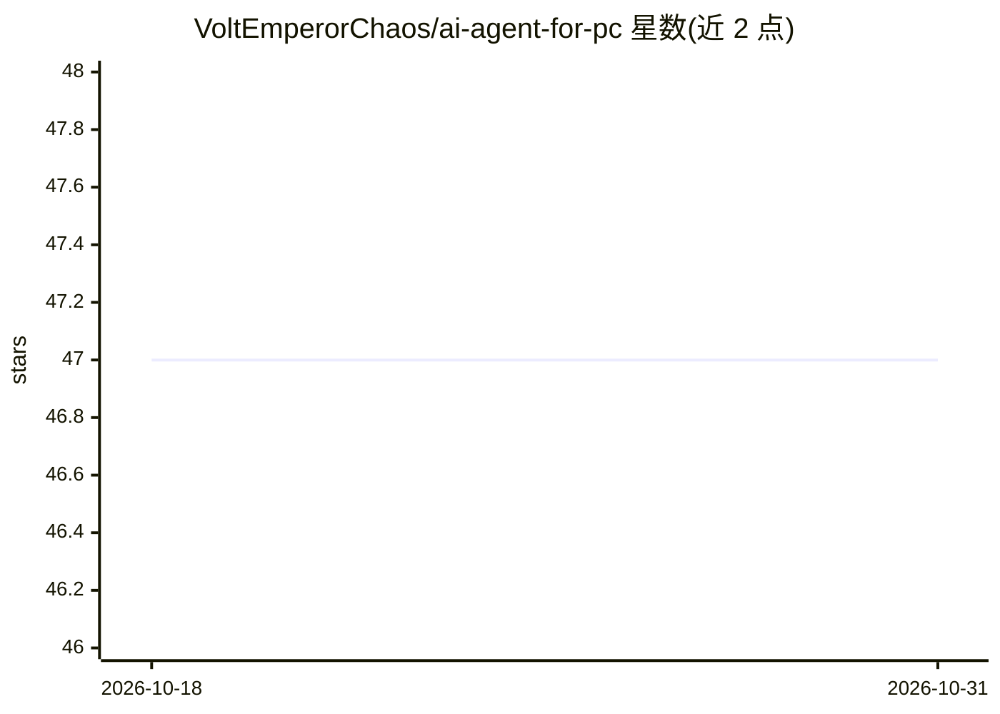

# VoltEmperorChaos/ai-agent-for-pc

⭐ 47 · 推送 2026-09-30 · [GitHub](https://github.com/VoltEmperorChaos/ai-agent-for-pc) · [官网](https://github.com/VoltEmperorChaos/ai-agent-for-pc) · 个人维护

**本地 Windows 单文件 AI agent：双击 .exe 即启动**

面向 Windows 个人电脑用户的轻量级 AI agent 桌面程序：以单个 .exe 文件分发，无需命令行、脚本或复杂配置，下载后双击即自动启动。README 未描述 agent 的具体能力（如可执行任务类型）或所依赖的模型后端。项目自述仍在开发中，功能后续可能增加。安装方式仅提供可执行文件一种路径，无源码构建或包管理器安装说明。

## 筛选速览

| 维度 | 判定 | 备注 |
|---|---|---|
| AI 角色 | `ai-native` | 本体是模型或模型工具 |
| 许可风险 | `none` | — |
| 部署形态 | `desktop` | 安装包/桌面程序 |
| 模型依赖 | — | README 未给出锁定关系 |
| 硬件要求 | — | 无带数字的原话,不猜 |
| 安装摩擦 | `low` | 无编译、无系统依赖或容器化 |
| 成熟度 | `idea` | |

## 能力要点

- 单 .exe 文件启动，无需命令行或脚本
- 在 Windows 上本地运行
- 面向初学者的极简安装流程

## 适用场景

- 不熟悉命令行的 Windows 用户快速启动本地 AI agent
- 个人电脑上以最低配置成本体验 AI agent

## 场景标签

`AI 助手` · 领域:对话与助手

## 证据(README 行号)

> L3: A simple and lightweight AI agent designed to run directly on a Windows PC.
> L9: You don't need to manually run scripts or use a command line to start the agent. Simply launch the `.exe` file and t

## 星数曲线

2026-10-18 47 → 2026-10-31 47（+0）

---
*卡片 v1 · prompt 1.4 · 生成 2026-10-25 · 置信度 mid · 依据 README sha `590f5ed441f6` · [字段定义](../../DATASET.md)*
