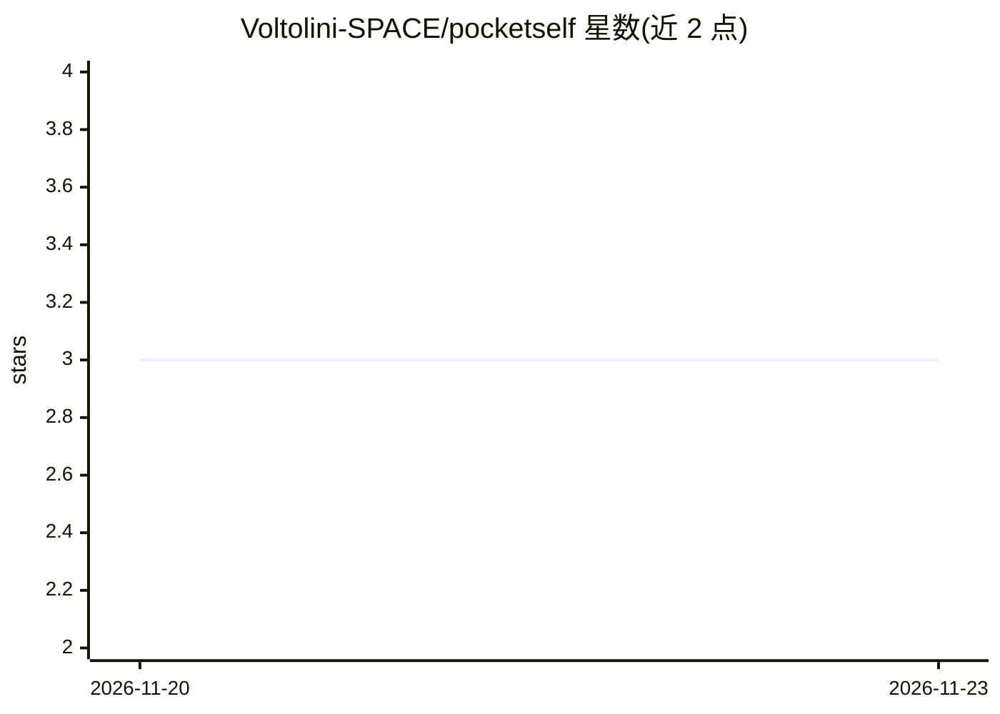

# Voltolini-SPACE/pocketself

⭐ 3 · Swift · NOASSERTION · 推送 2026-10-12 · [GitHub](https://github.com/Voltolini-SPACE/pocketself) · 个人维护

**iPhone 端全离线个人 AI 助理：语音通话、SOS 与设备控制**

运行在 iPhone 上的本地优先个人 AI 代理，SwiftUI + MLX 实现：离线实时语音通话（端上识别、本地模型回答、端上合成语音）、会议转写摘要、SOS 手电与 GPS、提醒/消息/日程等设备操作（均需用户确认）、照片读取、网页检索、用户可控记忆，以及可操作其他应用的端上 XCUITest 控制代理。模型引擎可选 Qwen/Gemma（MLX）、Apple Intelligence 或自建服务器。安装需 Mac + Xcode，通过脚本或文档指引部署到 iPhone；免费开源、无账号、无遥测。

## 筛选速览

| 维度 | 判定 | 备注 |
|---|---|---|
| AI 角色 | `ai-native` | 本体是模型或模型工具 |
| 许可风险 | `none` | NOASSERTION |
| 部署形态 | `None` |  |
| 模型依赖 | — | README 未给出锁定关系 |
| 硬件要求 | — | 无带数字的原话,不猜 |
| 安装摩擦 | `low` | 无编译、无系统依赖或容器化 |
| 成熟度 | — | 结构信号不足 |

## 能力要点

- 100% 端上离线实时语音通话，可随时打断
- MLX 运行 Qwen3.5 4B/9B 与 Gemma 4 E2B/E4B，可切换引擎保留历史
- SOS 摩尔斯手电与 GPS 完全无网可用
- 端上 XCUITest 代理可操作其他应用，外部生效动作需屏幕确认

## 适用场景

- 飞行模式或无信号环境下与 AI 语音对话
- 会议录音转写与摘要整理
- 通过自然语言让代理执行提醒、发消息等手机操作
- 按基准测试对比各本地模型在自己 iPhone 上的速度

## 场景标签

`AI 助手` `语音 Agent` · 领域:对话与助手

## 证据(README 行号)

> L12: **Chamada de voz ao vivo, 100% no iPhone:** você fala, ela responde em voz e você interrompe quando quiser — em mod
> L27: > **English (short):** PocketSelf is a free, MIT-licensed, local-first personal AI agent for iPhone (SwiftUI + MLX)
> L45: |✅ Chat local (Qwen3.5 4B/9B, Gemma 4 E2B/E4B via MLX)|troca de motor sem perder histórico|

## 星数曲线

2026-11-20 3 → 2026-11-23 3（+0）

---
*卡片 v1 · prompt 1.4 · 生成 2026-11-22 · 置信度 high · 依据 README sha `1617f1a73b91` · [字段定义](../../DATASET.md)*
