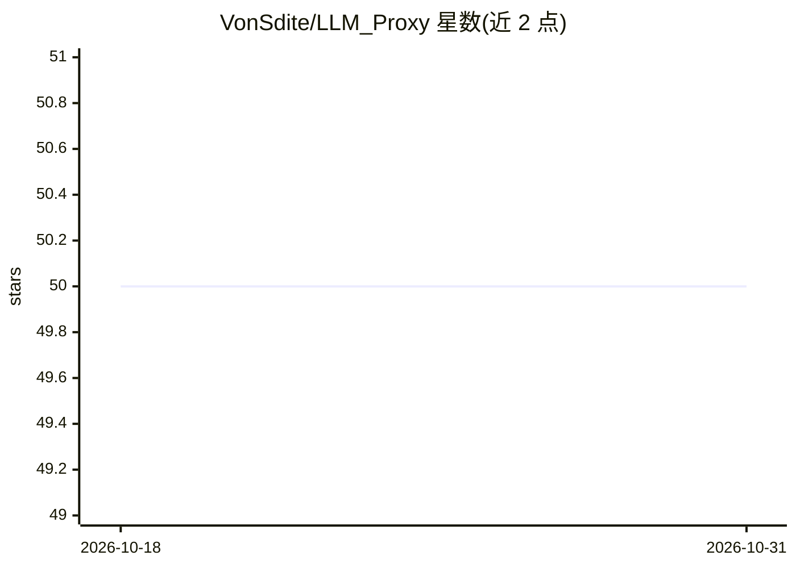

# VonSdite/LLM_Proxy

⭐ 50 · Python · 推送 2026-10-29 · [GitHub](https://github.com/VonSdite/LLM_Proxy) · 个人维护 · 中文 README

**统一 LLM 接入层：多上游多协议代理与凭据池管理**

基于 Flask + gevent 的统一 LLM 代理服务：对下游提供 OpenAI Chat Completions、OpenAI Responses 与 Claude Messages 三种兼容接口，对上游收敛多 Provider 与 Codex / Claude OAuth 账号文件代理。内置 Provider 管理、Auth Group 多 Key 池化调度（并发限制、429 冷却、请求与 Token 配额）、白名单、日志统计、请求 trace 调试、Hook 扩展与请求脱敏。面向需要在局域网或团队内网部署统一模型入口的开发者与团队；通过 pip 安装依赖并以 python main.py 运行。

## 筛选速览

| 维度 | 判定 | 备注 |
|---|---|---|
| AI 角色 | `ai-ecosystem` | LLM/agent 周边工具 |
| 许可风险 | `none` | — |
| 部署形态 | `library` | 以包/库形式分发 |
| 模型依赖 | locked-api |  |
| 硬件要求 | — | 无带数字的原话,不猜 |
| 安装摩擦 | `low` | 无编译、无系统依赖或容器化 |
| 成熟度 | — | 结构信号不足 |

## 能力要点

- 同一 Provider 同时服务 /v1/chat/completions、/v1/responses、/v1/messages 三种下游协议
- Codex / Claude OAuth 账号文件代理：登录认证、配额查询、候选切换
- Auth Group 多 Key 池化：并发限制、429 冷却、分钟/日请求与 Token 配额
- Hook 扩展机制与安全脱敏（凭据/敏感信息占位符替换）

## 适用场景

- 在 NAS 或内网服务器部署统一 LLM 入口，客户端只需记住一个地址
- 多个上游 Key 分摊压力，统一处理并发、配额与冷却
- 上游已切 Responses 而客户端仍走 Chat Completions 的协议迁移期兼容

## 场景标签

`模型网关` · 领域:Agent 开发

## 证据(README 行号)

> L3: > 一个面向多上游、多协议、多认证形态的统一 LLM 接入层。
> L5: LLM_Proxy 把模型服务、鉴权方式、协议转换和后台运维收敛到同一个 Flask + gevent 服务中，对下游提供 OpenAI Chat Completions、OpenAI Responses 和 Claude Mess
> L19: - 对下游保持稳定接口：支持 `POST /v1/chat/completions`、`POST /v1/responses`、`POST /v1/messages`、`GET /v1/models`

## 星数曲线

2026-10-18 50 → 2026-10-31 50（+0）

---
*卡片 v1 · prompt 1.4 · 生成 2026-10-24 · 置信度 high · 依据 README sha `b0790c271c42` · [字段定义](../../DATASET.md)*
