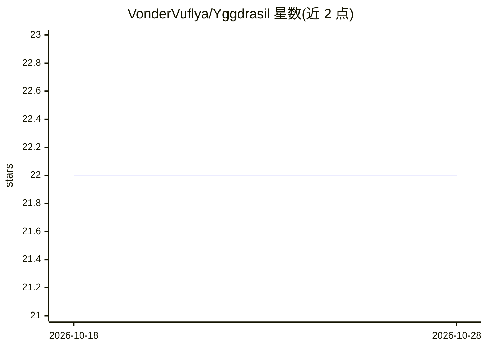

# VonderVuflya/Yggdrasil

⭐ 22 · Python · AGPL-3.0 · 推送 2026-10-25 · [GitHub](https://github.com/VonderVuflya/Yggdrasil) · 个人维护

**给 AI 编程 agent 的本地持久记忆层（MCP，零依赖）**

面向 Claude Code、Codex、OpenCode 及任意 MCP host 的本地记忆服务：以常驻守护进程提供 ygg_search/ygg_recall/ygg_remember 等 MCP 工具，会话启动钩子自动注入项目状态与待办。默认 SQLite+FTS5 关键词检索零依赖，可选本地嵌入模型（Ollama/llama.cpp 等）实现语义检索，可选小型 LLM 做后台去重合并。每条记忆同时是 Markdown 笔记；支持多机点对点同步，无云无账号。经由 uvx/npm/pipx/pip/Homebrew/源码安装。

## 筛选速览

| 维度 | 判定 | 备注 |
|---|---|---|
| AI 角色 | `ai-ecosystem` | LLM/agent 周边工具 |
| 许可风险 | `viral` | AGPL-3.0 |
| 部署形态 | `library` | 以包/库形式分发 |
| 模型依赖 | local-ok | 支持本地模型 |
| 硬件要求 | — | 无带数字的原话,不猜 |
| 安装摩擦 | `low` | 无编译、无系统依赖或容器化 |
| 成熟度 | `idea` | |

## 能力要点

- 常驻守护进程提供 MCP 工具，会话启动自动注入记忆（约300 tokens）
- 默认 SQLite+FTS5 零依赖；可选本地嵌入模型语义检索与后台 LLM 整理
- 所有记忆同时是可读可编辑的 Markdown 笔记（Obsidian 兼容）
- 多机直连同步：证书锁定、无中继服务器、离线可读写

## 适用场景

- 新开会话时让 AI 已知项目决策、坑与待办，无需重复解释
- 在多个编程工具（Claude Code/Codex/OpenCode）间共享同一记忆
- 从 Claude Code/Codex 历史记录或 Obsidian 库导入既有知识
- 笔记本电脑与工作站间保持记忆同步

## 场景标签

`Agent 记忆` · 领域:Agent 开发

## 证据(README 行号)

> L4: One local memory for Claude Code, Codex, and every MCP agent — shared across sessions, tools, and projects. Zero dep
> L108: - 🛎️ **Always-on daemon** — a tiny local service (~21 MB RAM) your agents reach over MCP tools (`ygg_search`, `ygg

## 星数曲线

2026-10-18 22 → 2026-10-28 22（+0）

---
*卡片 v1 · prompt 1.4 · 生成 2026-10-27 · 置信度 high · 依据 README sha `afcbe20636b2` · [字段定义](../../DATASET.md)*
