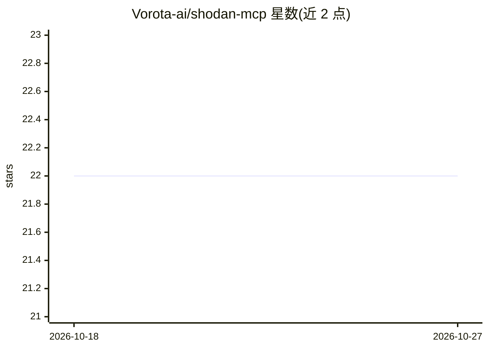

# Vorota-ai/shodan-mcp

⭐ 22 · Python · Apache-2.0 · 推送 2026-02-12 · [GitHub](https://github.com/Vorota-ai/shodan-mcp) · 组织维护

**让 AI agent 在 IDE 中调用 Shodan 的 MCP 服务器**

由 Vorota AI 开发的 Model Context Protocol 服务器，将 Shodan 互联网设备搜索引擎的查询能力接入 Claude Desktop、Claude Code、Cursor、VS Code Copilot、Windsurf、Cline 等 MCP 客户端。提供 20 个工具，覆盖 IP 侦察、CVE/CPE 漏洞情报、DNS 解析、域名分析与蜜罐检测；全部查询为被动模式，不向目标发包。其中 4 个工具（CVE 查询/搜索、CPE 搜索、InternetDB）无需 API key，其余 16 个需配置 Shodan API key。提供 Docker、uv、pip 三种安装方式。

## 筛选速览

| 维度 | 判定 | 备注 |
|---|---|---|
| AI 角色 | `ai-ecosystem` | LLM/agent 周边工具 |
| 许可风险 | `permissive` | Apache-2.0 |
| 部署形态 | `self-host` | docker 或自建部署 |
| 模型依赖 | locked-api |  |
| 硬件要求 | — | 无带数字的原话,不猜 |
| 安装摩擦 | `low` | 无编译、无系统依赖或容器化 |
| 成熟度 | — | 结构信号不足 |

## 能力要点

- 20 个工具覆盖被动侦察、CVE/CPE 情报、DNS 与设备搜索
- 4 个工具无需 API key 即可使用
- 全部查询走 Shodan 预索引数据库，被动设计不向目标发包
- 输入校验、注入防护、API key 不出现在日志/报错中

## 适用场景

- 在 IDE 中通过自然语言做资产侦察与漏洞研究
- 查询 CVE 详情、EPSS 评分与受影响 CPE
- 检查 IP 的开放端口、蜜罐分数与域名 DNS 记录

## 场景标签

`网络安全` · 领域:学习与行业

## 证据(README 行号)

> L3: **shodan-mcp** is a Model Context Protocol (MCP) server that gives AI agents like Claude, Cursor, and GitHub Copilot
> L76: - **Works with all MCP clients** -- Claude Desktop, Claude Code, Cursor, VS Code, Windsurf, Cline
> L120: shodan-mcp works with all major MCP clients: **Claude Desktop**, **Claude Code**, **Cursor**, **VS Code Copilot**,

## 星数曲线

2026-10-18 22 → 2026-10-27 22（+0）

---
*卡片 v1 · prompt 1.4 · 生成 2026-10-27 · 置信度 high · 依据 README sha `c452d52595ce` · [字段定义](../../DATASET.md)*
