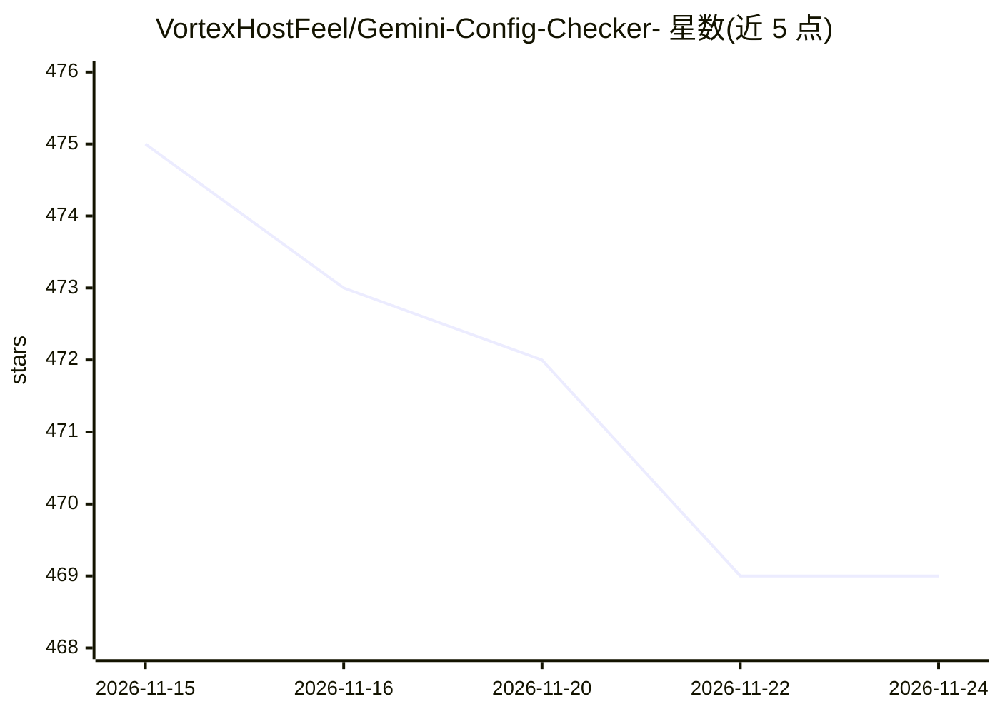

# VortexHostFeel/Gemini-Config-Checker-

⭐ 464 · Makefile · Apache-2.0 · 推送 2026-11-15 · [GitHub](https://github.com/VortexHostFeel/Gemini-Config-Checker-) · 个人维护

**检测哪些代理配置能进入 Google AI Studio 和 Gemini 的扫描工具**

面向使用代理配置访问 Google AI 服务的用户：以已登录浏览器实测每个配置能否通过 Gemini / AI Studio 的地区封锁判定，Simple 模式测试自有配置，Advanced 模式在可用基础配置后串联免费配置换取不同出口。内嵌 Xray-core 引擎，提供可编辑的 anti-DPI 分片配置（源自 PattN 配方），支持导出链接、base64 与完整 Xray 配置。跨平台分发桌面安装包（Windows/macOS/Linux）与 Android APK，Android 仅支持连通性检查。README 自述为 0.1.0 早期预发布，仅在 Windows 上完整验证过。

## 筛选速览

| 维度 | 判定 | 备注 |
|---|---|---|
| AI 角色 | `ai-enhanced` | 去掉 AI 部分产品仍成立 |
| 许可风险 | `permissive` | Apache-2.0 |
| 部署形态 | `desktop` | 安装包/桌面程序 |
| 模型依赖 | — | README 未给出锁定关系 |
| 硬件要求 | — | 无带数字的原话,不猜 |
| 安装摩擦 | `medium` | 含编译或系统依赖之一 |
| 成熟度 | `idea` | |

## 能力要点

- 以已登录 Chrome/Edge/Brave 浏览器读取 Google 对账号的地区判定（20-40 秒/配置）
- Simple/Advanced 双模式，Advanced 将免费配置串接在可用基础配置之后
- 可编辑的 anti-DPI 配置（Finalmask 分片、cipher、ALPN、Clean IP）
- 导出链接、base64 与单配置/链式 Xray 完整配置

## 适用场景

- 在已有的一批代理配置中筛出能打开 Gemini / AI Studio 的那些
- 基础配置能连但被 Google 地区墙拦截时，串接免费配置换取可用出口
- 在过滤网络环境中为 Cloudflare 配置应用 anti-DPI 设置后测试

## 场景标签

 · 领域:网络工具/代理配置检测

## 证据(README 行号)

> L11: Find proxy configs that actually get you into **Google AI Studio and Gemini**, by testing each one the way a person
> L50: Google decides region availability **per signed-in account, after the page has loaded**. A plain HTTP request (even
> L64: |Platform|Desktop app (native window)|Web server (UI in your browser)|Region check|

## 星数曲线

2026-11-15 475 → 2026-11-24 469（-6）

---
*卡片 v1 · prompt 1.4 · 生成 2026-11-17 · 置信度 high · 依据 README sha `846e83cebb20` · [字段定义](../../DATASET.md)*
