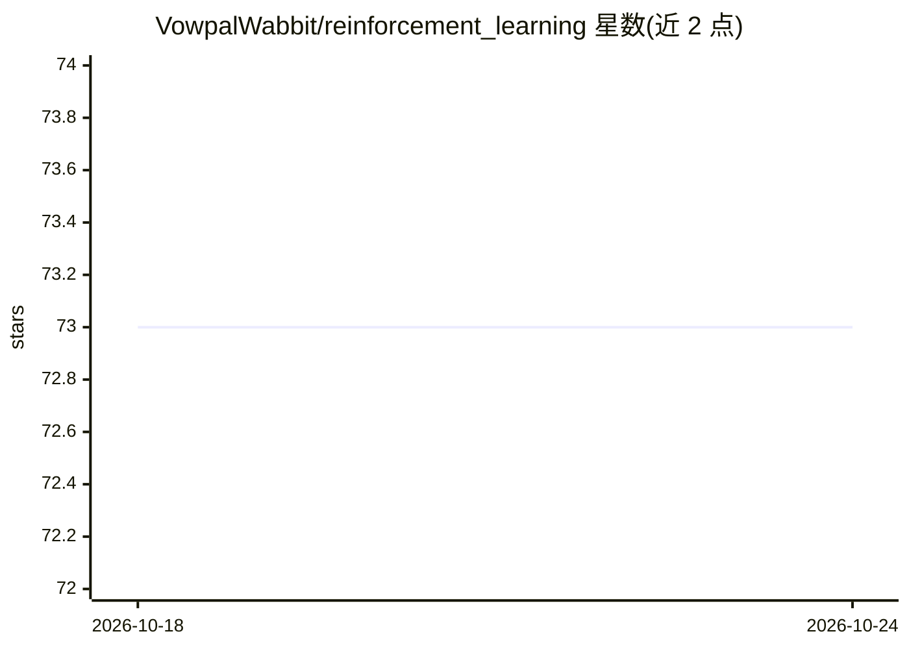

# VowpalWabbit/reinforcement_learning

⭐ 73 · C++ · MIT · 推送 2026-03-03 · [GitHub](https://github.com/VowpalWabbit/reinforcement_learning) · 组织维护

**强化学习交互循环的 C++ 客户端库：Predict/Log/Learn/Update**

Vowpal Wabbit 生态的交互侧集成库，为在线强化学习回路提供 Predict、Log、Learn、Update 等接口，并声明与最新版 VW 集成。面向需要在应用中嵌入强化学习决策循环的开发者，以 C++ 库形式提供源码构建：支持 Vcpkg + CMake Presets 一条路径，另给出 Ubuntu（apt + vcpkg）、macOS（homebrew）、Windows（vcpkg + Visual Studio）的系统特定构建说明。依赖 Boost、OpenSSL、cpprestsdk、flatbuffers 等，README 含 OpenSSL 与 cpprestsdk 的排障说明。

## 筛选速览

| 维度 | 判定 | 备注 |
|---|---|---|
| AI 角色 | `ai-ecosystem` | LLM/agent 周边工具 |
| 许可风险 | `permissive` | MIT |
| 部署形态 | `None` |  |
| 模型依赖 | — | README 未给出锁定关系 |
| 硬件要求 | — | 无带数字的原话,不猜 |
| 安装摩擦 | `medium` | 含编译或系统依赖之一 |
| 成熟度 | — | 结构信号不足 |

## 能力要点

- 提供 Predict / Log / Learn / Update 的 RL 交互循环接口
- 与最新版 Vowpal Wabbit 集成（CI 跟踪）
- 覆盖 Linux/macOS/Windows 三平台的构建说明（Vcpkg+CMake、apt、homebrew、Visual Studio）

## 适用场景

- 在生产服务中嵌入在线强化学习的预测与学习循环
- 需要低延迟客户端库对接 Vowpal Wabbit 决策服务的场景
- 跨平台 C++ 环境下搭建 RL 日志与更新链路

## 场景标签

 · 领域:机器学习/强化学习基础设施

## 证据(README 行号)

> L6: # RL Client Library
> L7: Interaction-side integration library for Reinforcement Learning loops: Predict, Log, [Learn,] Update
> L4: Integration with latest VW

## 星数曲线

2026-10-18 73 → 2026-10-24 73（+0）

---
*卡片 v1 · prompt 1.4 · 生成 2026-10-24 · 置信度 high · 依据 README sha `4aa976acb515` · [字段定义](../../DATASET.md)*
