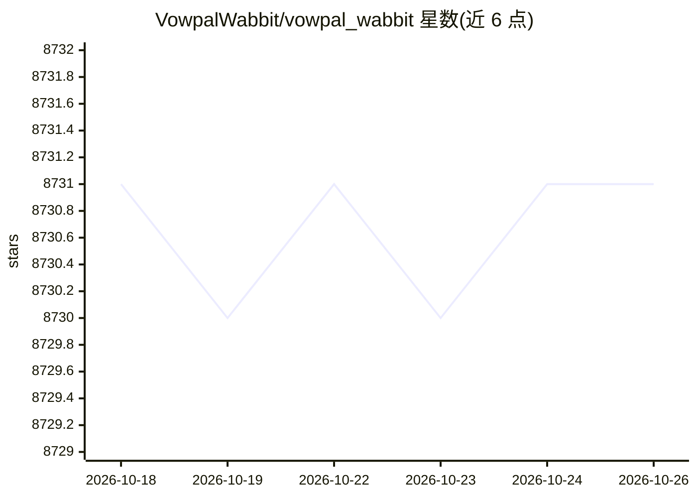

# VowpalWabbit/vowpal_wabbit

⭐ 8,731 · C++ · NOASSERTION · 推送 2026-10-15 · [GitHub](https://github.com/VowpalWabbit/vowpal_wabbit) · [官网](https://vowpalwabbit.org) · 组织维护

**快速在线机器学习系统，供开发者训练预测模型**

C++ 实现的在线机器学习系统，面向算法开发者与研究员：支持在线学习、哈希技巧（特征空间与数据量解耦）、allreduce 分布式、reductions、learning2search、主动学习与交互学习，重点实现多种 contextual bandit 强化学习算法。输入格式支持自由文本 bag-of-words 与多命名空间特征，内存占用不随数据量增长，训练集无需预先载入内存。提供命令行工具与 Python 绑定，附命令行 demo 与 Jupyter 示例；安装与构建细节指向 wiki，README 本身未给出具体命令。

## 筛选速览

| 维度 | 判定 | 备注 |
|---|---|---|
| AI 角色 | `ai-native` | 本体是模型或模型工具 |
| 许可风险 | `none` | NOASSERTION |
| 部署形态 | `None` |  |
| 模型依赖 | — | README 未给出锁定关系 |
| 硬件要求 | — | 无带数字的原话,不猜 |
| 安装摩擦 | `low` | 无编译、无系统依赖或容器化 |
| 成熟度 | — | 结构信号不足 |

## 能力要点

- 在线学习架构，内存占用与数据量解耦（hashing trick）
- 多种 contextual bandit 强化学习算法实现
- 输入支持自由文本 bag-of-words 与多命名空间特征
- 提供命令行工具与 Python 绑定、示例及教程

## 适用场景

- 大规模数据上做在线学习与预测训练
- 实现与试验 contextual bandit 类强化学习算法
- 排序问题中的特征交叉与稀疏梯度下降训练

## 场景标签

 · 领域:机器学习/算法库

## 证据(README 行号)

> L12: Vowpal Wabbit is a machine learning system which pushes the frontier of machine learning with techniques such as on
> L15: - **Speed.** The learning algorithm is fast -- similar to the few other online algorithm implementations out there.

## 星数曲线

2026-10-18 8,731 → 2026-10-26 8,731（+0）

---
*卡片 v1 · prompt 1.4 · 生成 2026-10-20 · 置信度 high · 依据 README sha `bc1815db7595` · [字段定义](../../DATASET.md)*
