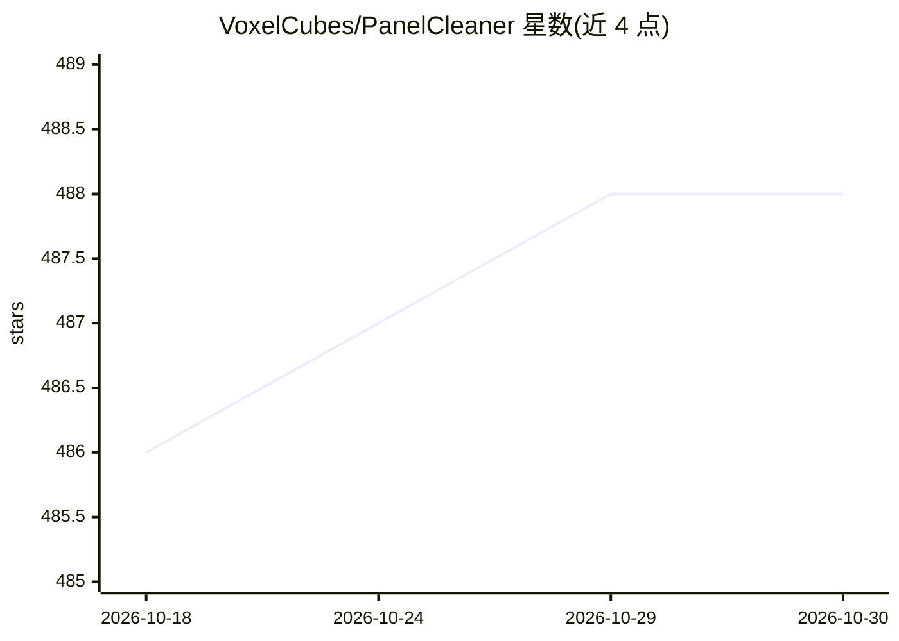

# VoxelCubes/PanelCleaner

⭐ 488 · Python · GPL-3.0 · 推送 2026-09-22 · [GitHub](https://github.com/VoxelCubes/PanelCleaner) · 个人维护

**用机器学习自动清除漫画气泡文字的清理工具**

面向漫画翻译/清理人员的 CLI 与 GUI 工具：用机器学习模型检测气泡文字并生成遮罩覆盖，附带遮罩扩展、边缘降噪、LaMa 修补等后处理以减少残留与伪影；支持批量处理、配置 Profile、CUDA 加速（仅 pip 安装方式）、日文/英文 OCR（MangaOCR/Tesseract）。限制：仅支持日英文字清洗、遮罩仅灰度气泡、约 2–8% 气泡可能检测失败并被跳过。首次启动需下载约 500MB 模型数据。

## 筛选速览

| 维度 | 判定 | 备注 |
|---|---|---|
| AI 角色 | `ai-native` | 本体是模型或模型工具 |
| 许可风险 | `viral` | GPL-3.0 |
| 部署形态 | `self-host` | docker 或自建部署 |
| 模型依赖 | — | README 未给出锁定关系 |
| 硬件要求 | — | 无带数字的原话,不猜 |
| 安装摩擦 | `low` | 无编译、无系统依赖或容器化 |
| 成熟度 | — | 结构信号不足 |

## 能力要点

- ML 检测气泡文字并生成遮罩，含遮罩扩展与边缘降噪后处理
- LaMa 机器学习修补无法直接遮盖的气泡
- 批量处理图像/目录，Profile 文本配置可保存多套参数
- 日文 OCR 由 MangaOCR 开箱支持，可选 Tesseract 处理英/日文

## 适用场景

- 批量清除漫画页面气泡文字，省去单调的手工清理
- 导出透明遮罩层用于后续翻译排版
- 对漫画页面做日文/英文 OCR 并导出文本辅助翻译

## 场景标签

`图像视频处理` `OCR` · 领域:感知与多模态

## 证据(README 行号)

> L9: This tool uses machine learning to find text and then generates masks to cover it up with the highest accuracy possi
> L37: - Inpaints bubbles (with LaMa machine learning) that can't simply be masked out.

## 星数曲线

2026-10-18 486 → 2026-10-30 488（+2）

---
*卡片 v1 · prompt 1.4 · 生成 2026-10-21 · 置信度 high · 依据 README sha `eb8217afc19c` · [字段定义](../../DATASET.md)*
