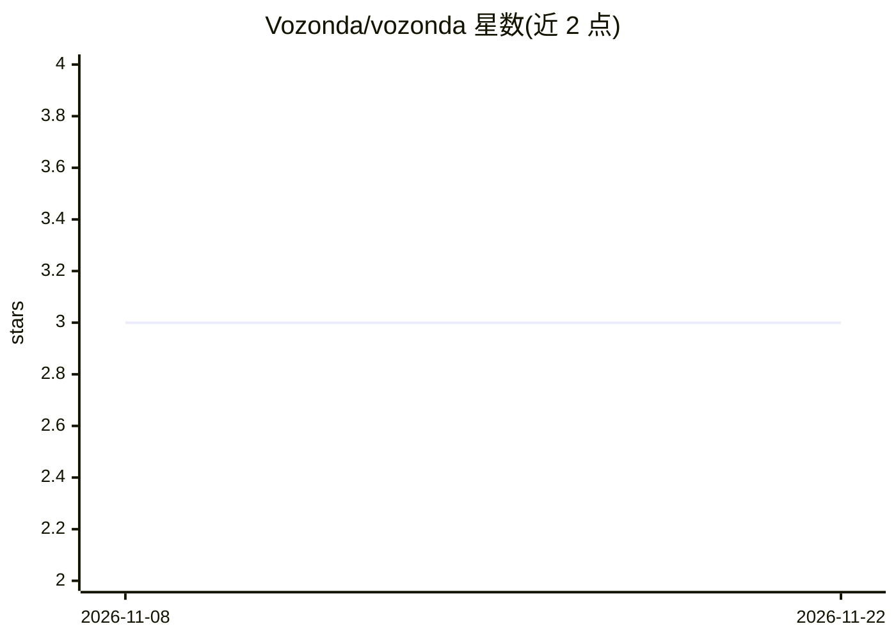

# Vozonda/vozonda

⭐ 3 · Python · MIT · 推送 2026-11-18 · [GitHub](https://github.com/Vozonda/vozonda) · [官网](https://vozonda.com) · 组织维护

**自托管工具：把文章/PDF/RSS 源转成播客音频**

自托管的源转播客工具：读取文章、论文、PDF、音频、YouTube、RSS 等来源，经 LLM 脚本生成与 TTS 配音两个阶段产出带章节、转录稿、要点的播客剧集，发布到私有 RSS feed（可选 Nostr）。脚本阶段使用用户自己的 OpenAI 兼容端点（默认 Ollama），语音默认用 Kokoro 在 CPU 上运行，无需 GPU。以 Docker 为主的单用户本地优先应用，另提供 PyPI 包与 MCP 服务器接口供 agent 调用。

## 筛选速览

| 维度 | 判定 | 备注 |
|---|---|---|
| AI 角色 | `ai-native` | 本体是模型或模型工具 |
| 许可风险 | `permissive` | MIT |
| 部署形态 | `self-host` | docker 或自建部署 |
| 模型依赖 | local-ok | 支持本地模型 |
| 硬件要求 | `cpu-ok` | |
| 安装摩擦 | `low` | 无编译、无系统依赖或容器化 |
| 成熟度 | — | 结构信号不足 |

## 能力要点

- 14 种节目格式，1-3 个声音，10 种语言并可翻译源文本
- 音频源本地转录；默认 Kokoro TTS 在 CPU 运行，无需 GPU
- RSS watchlist 按日程自动生成摘要剧集填入 feed
- 提供 MCP 服务器（Claude Code、VS Code 等 host 可调用 11 个工具）

## 适用场景

- 把我订阅的 RSS 源自动变成每日/每周播客摘要
- 把论文和 PDF 转成可以边听边看的对谈节目
- 在本地自托管环境中生成不依赖云服务的播客

## 场景标签

`语音合成` · 领域:内容生成

## 证据(README 行号)

> L4:  Turn sources into your podcast
> L43: - **Self-hosted:** Runs on your own hardware with Docker. Voice generation runs on CPU by default with Kokoro, so n
> L92: input            script stage (LLM)                 voice stage (TTS)            output

## 星数曲线

2026-11-08 3 → 2026-11-22 3（+0）

---
*卡片 v1 · prompt 1.4 · 生成 2026-11-22 · 置信度 high · 依据 README sha `6429f56279e8` · [字段定义](../../DATASET.md)*
